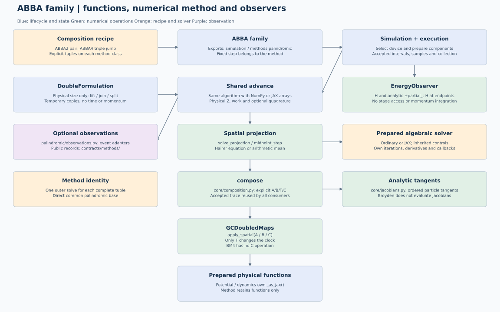

# ABBA family: shared palindromic execution

All presets now inherit PalindromicMethod and execute explicit A/B/T operations.
See [palindromic methods and time placement](../../palindromic/simulation/palindromic-operations.md) for the common classes, generic recipes and independent C.

The compact diagrams describe the current shared numerical execution and executor-owned lifecycle. Older detailed diagrams explicitly marked as historical retain their original ownership conventions.

ABBA2 declares one pair; ABBA4 declares its complete triple-jump tuple. Each implicit method applies one projection around its full composition.

The numerical implementation now lives in `src/methods/palindromic/`.
ABBA2Implicit, ABBA4Implicit and BM4Implicit directly share
ProjectedPalindromicMethod. ABBA6 is removed from the current API. The former `methods/abba/` and
`methods/bm4/` import adapters have been removed. Internal imports point directly
to the defining modules in `methods.palindromic`.

See the [shared architecture](../../palindromic/simulation/palindromic-simulation-architecture.md)
for the module responsibilities, state layouts, solver equations, energy
normalization and validation contracts. The model's mathematical entry point
remains [theory.tex](../tex/theory.tex), with its compiled
[theory.pdf](../tex/theory.pdf).

## Numerical path

Scalar option validators are defined in `methods._validation`; projection and
state-extension selectors remain in `methods.palindromic.configuration`. Internal
consumers import numeric validators from their defining module. Newton and
Broyden share initial-vector, stopping-control and residual validation in
`solvers.nonlinear`. Cached residuals are checked without another evaluation;
singularity, stagnation and convergence checks stay inside the numerical loops.

Initialization binds this model's recipe and options. The ordinary implicit
path is `advance -> solve_projection -> compose -> A/B/T/C operations`.
Explicit midpoint methods use `midpoint_step` in place of the nonlinear
projection. ABBA4 projects once around its complete unprojected six-stage composition.

The reduced and simultaneous formulations use the same shared spatial
projection engine. Newton uses exact particle-block Jacobians and Broyden uses
residual-only secant updates.

The shared composition keeps signed durations and the nonautonomous stage
clock: adjoint maps evaluate at the start of their substep and direct maps at
its end. ABBA uses no harmonic coupling. BM4 retains its configurable coupling
and the existing defaults for each public class.

## Accepted states and diagnostics

`EnergyObserver()` records physical H and the positive analytic partial time derivative `hamiltonian_time_derivative` at accepted endpoints and requested physical samples. It does not consume internal stages or integrate momentum. Per-step diagnostics are `energy_start`, `energy_end`, `energy_change`, `energy_time_derivative_start` and `energy_time_derivative_end`, with shape `(steps,N)`. Saved histories `physical_hamiltonian` (alias `hamiltonian`), `energy_drift` and `hamiltonian_time_derivative` have shape `(N,T)`. Energy variation in a time-dependent Hamiltonian is not a numerical conservation error.

In specialized historical energy studies, the accepted shear trace feeds normalized momentum quadrature after the
spatial computation. The diagnostic `H + kappa - H_initial` measures energy
balance for the time-dependent Hamiltonian. Tracking does not alter the spatial
map or its nonlinear stopping scale. Analytic tangents and BM4 stage events reuse
the retained spatial stages; no extra spatial replay is required for them.

The integration coordinator still owns accepted intervals, off-grid output
sampling, history collection and observer dispatch. Energy arrays follow saved
times and nonlinear-work arrays follow accepted main steps. Existing method
and observer tests remain applicable, supplemented by
`tests/test_palindromic_family.py`.

## Diagram maintenance

Regenerate this diagram and the shared family view with
`python scripts/render_palindromic_architecture.py`. The script writes the
PlantUML/Graphviz source and corresponding SVG/PNG views from the same graph
specification. Historical files marked `old` or `proposed` are archival diagrams;
the figure above describes the current implementation.

## Complete integration executor

`simulate(problem, method, execution=Execution())` delegates the complete
job to `Execution.run`. Import the executor with `from execution import Execution`.
The executor prepares the requested environment and a fresh numerical run, allocates one recorder, invokes the host or compiled worker and finalizes the result once. It owns run status on success and failure. It does not change thread counts, affinity
or global JAX settings. Subclasses can execute the same job elsewhere, while
`simulate` validates the completed `States`. Backend choices remain separate in
`options=ExecutionOptions(...)`. See the [executor contract](../../../simulation/execution.md).
Numerical stages, projection equations and step controllers retain their own
implementations inside this execution boundary. The base class is
`methods.base.IntegrationMethod`; time loops and sampling live inside `execution`,
with no separate integration package.

`Execution_Modal` now implements this boundary for remote NumPy/SciPy CPU
integrations. Results return to the local machine for validation and subsequent
persistence; see the [Modal executor guide](../../../simulation/modal-execution.md).

## Initial-state ownership

`InitialValueProblem(dynamics, initial_state, layout=...)` captures a validated
physical array, particle count and independent layout. Later edits to the input
array do not change the prepared formulation. Physical layouts belong to
`dynamics.coordinates`; compatible structural layouts require no inheritance. Built-in dynamics keep their physical parameters
immutable. See the shared [layout and ownership contract](../../../dynamics/protocols.md#physical-layouts-and-problem-ownership).

## Compiled fixed-step contract

Fixed-step methods use the same `advance` implementation with NumPy or JAX
arrays. They contain no JAX imports, backend declaration or alternate stages.
Execution owns compatibility checks and device selection; `execution._jax_step`
binds an isolated prepared method to `contracts.methods.compiled.CompiledStep`.
Potential, dynamics and solvers own their internal `_as_jax()` preparation.
`Execution.run` first builds a shared fixed-step and sampling plan for host
and JAX execution. It passes this plan to `execution._jax_fixed.prepare_integration`
to place inputs and compile the complete loop before `run_steps` executes the
returned `PreparedIntegration` and records its results.
See [JAX execution](../../../simulation/jax-execution.md).

## Potential evaluation boundary

`Potential.evaluate` uses NumPy/SciPy; `JaxPotential` inherits its representation
and overrides only `evaluate` with JAX. Simulation preparation constructs
`JaxGuidingCenterDynamics` or `JaxFullCyclotronDynamics` from
`dynamics.jax_dynamics`; these subclasses only declare `JaxGCCoordinates` or `JaxFCCoordinates`
and inherit all physical methods. It supplies JAX potentials sharing the existing
splines, including the
gyroaveraged field, without refitting or mutating the source dynamics. Inherited
electric fields follow the potential class; `evaluate_grid` remains NumPy-only. See the
[shared potential contract](../../../dynamics/jax-potential-evaluation.md).

Initial data are packed NumPy arrays, including the output of `states.generators`. `dynamics.coordinates` supplies GC/FC layouts; `request.SimulationRequest` owns the initial time and output schedule. Controllers manage the current internal `IntegrationState`; `states.States` stores physical samples and becomes the completed result. Several methods can share a formulation. See the [migration guide](../../../simulation/api-migration.md).

## Initial data and numerical components

The public problem constructor also accepts `states.InitialConditions`; existing
packed-array callers remain supported. See the [component interface](../../../simulation/initial-solvers-formulations.md)
for ownership, array shapes and unchanged request/result boundaries.

ABBA separates `ReducedProjection` and `SimultaneousProjection` in
`methods.projection`; the method provides the composition and its derivative.
The equation object owns the 2N/6N residual and reconstruction. `solver=` accepts
`NewtonSolver(...)` or `BroydenSolver(...)`; nonlinear tolerances and derivative
options belong exclusively to those objects. CPU and JAX use the same equation classes.

## State representation and step preparation

`DoubleFormulation(physical_size)` is the only state formulation. It prepares temporary copies through `lift`, `join_copies` and `split_copies`, preserving NumPy/JAX arrays and complete component blocks. Runge--Kutta and HBVM methods use the physical vector directly and instantiate no formulation. The doubled representation stores only a positive physical size; it contains no dynamics, solver or diagnostic state.

Every accepted snapshot is `IntegrationState(time, values)`: scalar time and a physical vector of shape `(d*N,)`. GC remains 2N and FC 4N with or without energy observation. Temporary doubled GC work has 4N entries; generic doubled FC work has 8N. These workspaces never become accepted states. This generic copy support does not extend GC numerical methods to FC.

`new_run(f, initial_conditions, *, jacobian=None)` creates a fresh run and calls `initialize(initial_conditions)`. Initial data and layout are temporary preparation inputs: the numerical base retains only functions, numerical metadata, run status and copy count. Execution owns the initial snapshot and passes it explicitly to controllers. Supplied Jacobians have independent particle shape `(N,d,d)`; finite-difference Jacobians remain dense. There is no `jacobian_structure`, `capture_quadrature` or method-level `progress` option.

## Integration step

This method owns its positive `step` (default 0.1 in runtime time units).
Complete steps retain that size; only the final accepted step is shortened.
`advance` receives the effective duration without modifying the configured value.
See the [shared scheduling contract](../../../simulation/execution.md#method-owned-integration-step)
for independent output sampling and the common CPU/JAX grid.
