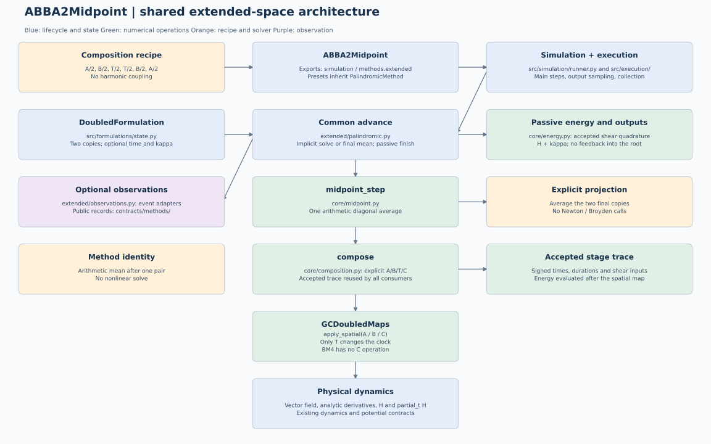

# ABBA2Midpoint: shared extended-space execution

All presets now inherit PalindromicMethod and execute explicit A/B/T operations.
See [palindromic methods and time placement](../../extended/simulation/palindromic-operations.md) for the common classes, generic recipes and independent C.

The compact diagrams describe the current shared numerical execution and executor-owned lifecycle. Older detailed diagrams explicitly marked as historical retain their original ownership conventions.

adjoint(h/2), direct(h/2); No harmonic coupling. Arithmetic mean after one pair; No nonlinear solve.

The numerical implementation now lives in `src/methods/extended/`.
ABBA2Implicit, ABBA4Implicit and BM4Implicit directly share
ProjectedPalindromicMethod. ABBA6 is removed from the current API. The former `methods/abba/` and
`methods/bm4/` import adapters have been removed. Internal imports point directly
to the defining modules in `methods.extended`.

See the [shared architecture](../../extended/simulation/extended-simulation-architecture.md)
for the module responsibilities, state layouts, solver equations, energy
normalization and validation contracts. The model's mathematical entry point
remains [theory.tex](../tex/theory.tex), with its compiled
[theory.pdf](../tex/theory.pdf).

## Numerical path

Initialization binds this model's recipe and options. The ordinary implicit
path is `advance -> solve_projection -> compose -> A/B/T/C operations`.
Explicit midpoint methods use `midpoint_step` in place of the nonlinear
projection. ABBA4 projects once around its complete unprojected six-stage composition.

The arithmetic projection averages the two copies once after the complete
recipe. It has no nonlinear solver and does not imply exact symplecticity or
reversibility.

The shared composition keeps signed durations and the nonautonomous stage
clock: adjoint maps evaluate at the start of their substep and direct maps at
its end. ABBA uses no harmonic coupling. BM4 retains its configurable coupling
and the existing defaults for each public class.

## Accepted states and diagnostics

For N planar particles the accepted state has 2N physical components. Time is scalar; an optional energy observer owns N separate physical momentum entries. The composition prepares two temporary spatial copies with 4N components, then returns a single physical state. Time and momentum never enter a nonlinear root.

The accepted shear trace feeds common normalized momentum quadrature after the
spatial computation. The diagnostic `H + kappa - H_initial` measures energy
balance for the time-dependent Hamiltonian. Tracking does not alter the spatial
map or its nonlinear stopping scale. Analytic tangents and BM4 stage events reuse
the retained spatial stages; no extra spatial replay is required for them.

The integration coordinator still owns accepted intervals, off-grid output
sampling, history collection and observer dispatch. Energy arrays follow saved
times and nonlinear-work arrays follow accepted main steps. Existing method
and observer tests remain applicable, supplemented by
`tests/test_extended_family.py`.

## Diagram maintenance

Regenerate this diagram and the shared family view with
`python scripts/render_extended_architecture.py`. The script writes the
PlantUML/Graphviz source and corresponding SVG/PNG views from the same graph
specification. Historical files marked `old` or `proposed` are archival diagrams;
the figure above describes the current implementation.

## Optional JAX execution

This model supports `simulate(..., options=ExecutionOptions(backend="jax", device="cpu"))`
(or a configured `device="gpu"`) with explicit float64. The complete fixed time
loop, particle stages, applicable nonlinear/projection solves and passive energy
quadrature remain on that device until final NumPy `States` export. Its
coefficients, physical-state tolerance scaling and sampling conventions are
unchanged. JAX rejects unconverged solves explicitly. Diagnostics report
`execution_mode="device_resident"`. Python step observers and progress reporting
require the default CPU path.

Import `ExecutionOptions` from `execution.options`. Omission preserves existing
SciPy/NumPy execution. See the [shared execution contract](../../../simulation/jax-execution.md)
for supported physical systems, solver details, timing scope and validation.

## Complete integration executor

`simulate(problem, method, execution=Execution())` delegates the complete
job to `Execution.run`. Import the executor with `from execution import Execution`.
The executor prepares the requested environment and a fresh numerical run, allocates one recorder, invokes the host or compiled worker and finalizes the result once. It owns run status on success and failure. It does not change thread counts, affinity
or global JAX settings. Subclasses can execute the same job elsewhere, while
`simulate` validates the completed `States`. Backend choices remain separate in
`options=ExecutionOptions(...)`. See the [executor contract](../../../simulation/execution.md).
Numerical stages, projection equations and step controllers retain their own
implementations inside this execution boundary. The base class is
`methods.base.IntegrationMethod`; time loops and sampling live inside `execution`,
with no separate integration package.

`Execution_Modal` now implements this boundary for remote NumPy/SciPy CPU
integrations. Results return to the local machine for validation and subsequent
persistence; see the [Modal executor guide](../../../simulation/modal-execution.md).

## Initial-state ownership

Dynamics declare `GCCoordinates()` for fixed `(x, y)` blocks or `FCCoordinates()` for fixed `(x, y, vx, vy)` blocks, from `dynamics.coordinates`. `PhysicalCoordinates` is a stateless base with common array operations; dimensions are fixed properties and no names or role-index fields are configured. `split()` returns an ordinary tuple. `JaxGCCoordinates` and `JaxFCCoordinates`, from `dynamics.jax_coordinates`, inherit their respective operations and only select `jnp` through `array_namespace`.

`InitialValueProblem` takes the dynamics declaration or requires an explicit layout. It never infers a model from dimension. `StateLayout.snapshot()` explicitly supplies an immutable NumPy convention; `describe_coordinates` validates that snapshot and its dimension. Compatibility compares the snapshot class and equality, even for equally sized arrays. Initial conditions and results own their arrays and conventions without retaining live dynamics or a potential. Custom conventions derive from `PhysicalCoordinates` and implement fixed operations instead of role tables; external adapters may supply these snapshots without inheritance. Packing and views preserve `(d*N,*samples)`, `(d,N,*samples)` and `(N,*samples)`. The respective JAX classes support tracing; incomplete blocks are rejected.

Built-in dynamics keep physical parameters immutable. A new problem is required for revised initial values. States stores time rows `(T,d*N)`, with `states[i]` at `t[i]`; component accessors retain `(N,T)`. New solution archives use schema 2; the reader converts schema 1 columns explicitly. Archives can be interpreted without constructing dynamics or loading a field.

## Compiled fixed-step contract

Fixed-step methods use the same `advance` implementation with NumPy or JAX
arrays. They contain no JAX imports, backend declaration or alternate stages.
Execution owns compatibility checks and device selection; `execution._jax_step`
binds an isolated prepared method to `contracts.methods.compiled.CompiledStep`.
Potential, dynamics and solvers own their internal `_as_jax()` preparation.
`Execution.run` first builds a shared fixed-step and sampling plan for host
and JAX execution. It passes this plan to `execution._jax_fixed.prepare_integration`
to place inputs and compile the complete loop before `run_steps` executes the
returned `PreparedIntegration` and records its results.
See [JAX execution](../../../simulation/jax-execution.md).

## Potential evaluation boundary

`Potential.evaluate` uses NumPy/SciPy; `JaxPotential` inherits its representation
and overrides only `evaluate` with JAX. Simulation preparation constructs
`JaxGuidingCenterDynamics` or `JaxFullCyclotronDynamics` from
`dynamics.jax_dynamics`; these subclasses only declare `JaxGCCoordinates` or `JaxFCCoordinates`
and inherit all physical methods. It supplies JAX potentials sharing the existing
splines, including the
gyroaveraged field, without refitting or mutating the source dynamics. Inherited
electric fields follow the potential class; `evaluate_grid` remains NumPy-only. See the
[shared potential contract](../../../dynamics/jax-potential-evaluation.md).

Dynamics declare `GCCoordinates()` for fixed `(x, y)` blocks or `FCCoordinates()` for fixed `(x, y, vx, vy)` blocks, from `dynamics.coordinates`. `PhysicalCoordinates` is a stateless base with common array operations; dimensions are fixed properties and no names or role-index fields are configured. `split()` returns an ordinary tuple. `JaxGCCoordinates` and `JaxFCCoordinates`, from `dynamics.jax_coordinates`, inherit their respective operations and only select `jnp` through `array_namespace`.

## Initial data and numerical components

The public problem constructor also accepts `states.InitialConditions`; existing
packed-array callers remain supported. See the [component interface](../../../simulation/initial-solvers-formulations.md)
for ownership, array shapes and unchanged request/result boundaries.

## State representation and step preparation

`DoubleFormulation(physical_size)` is the only state formulation. It prepares temporary copies through `lift`, `join_copies` and `split_copies`, preserving NumPy/JAX arrays and complete component blocks. Classical, HBVM and adaptive methods use the physical vector directly and instantiate no formulation. The doubled representation stores only a positive physical size; it contains no dynamics, solver or diagnostic state.

Every accepted snapshot is `IntegrationState(time, values)`: scalar time and a physical vector of shape `(d*N,)`. GC remains 2N and FC 4N with or without energy observation. Temporary doubled GC work has 4N entries; generic doubled FC work has 8N. These workspaces never become accepted states. This generic copy support does not extend GC numerical methods to FC.

Execution binds the physical functions and calls `new_run(f, initial_conditions, request, jacobian=..., jacobian_structure=...)`. The method receives no `DynamicalSystem` or problem. `advance(t, Z, h)` returns physical state, statistics, optional details and optional quadrature data. `EnergyObserver` owns its independent momentum and accumulates only accepted quadrature; shadow samples derive from the accepted observer state without committing it. Step callbacks are passed through `simulate(..., observers=(...,))`.

Enable passive energy with `simulate(..., observers=(EnergyObserver(),))`, importing `EnergyObserver` from `diagnostics.methods.energy`. Execution supplies the observer with H and `-partial_t H`. It evaluates saved physical H once and constructs the existing diagnostics. Energy labels and `(N,T)` auxiliary histories remain unchanged; `extended_time` is broadcast from scalar sample times. Old configured Python objects must be recreated; saved numerical archives remain readable through versioned history conversion.

## Integration step

This method owns its positive `step` (default 0.1 in runtime time units).
Complete steps retain that size; only the final accepted step is shortened.
`advance` receives the effective duration without modifying the configured value.
See the [shared scheduling contract](../../../simulation/execution.md#method-owned-integration-step)
for independent output sampling and the common CPU/JAX grid.
