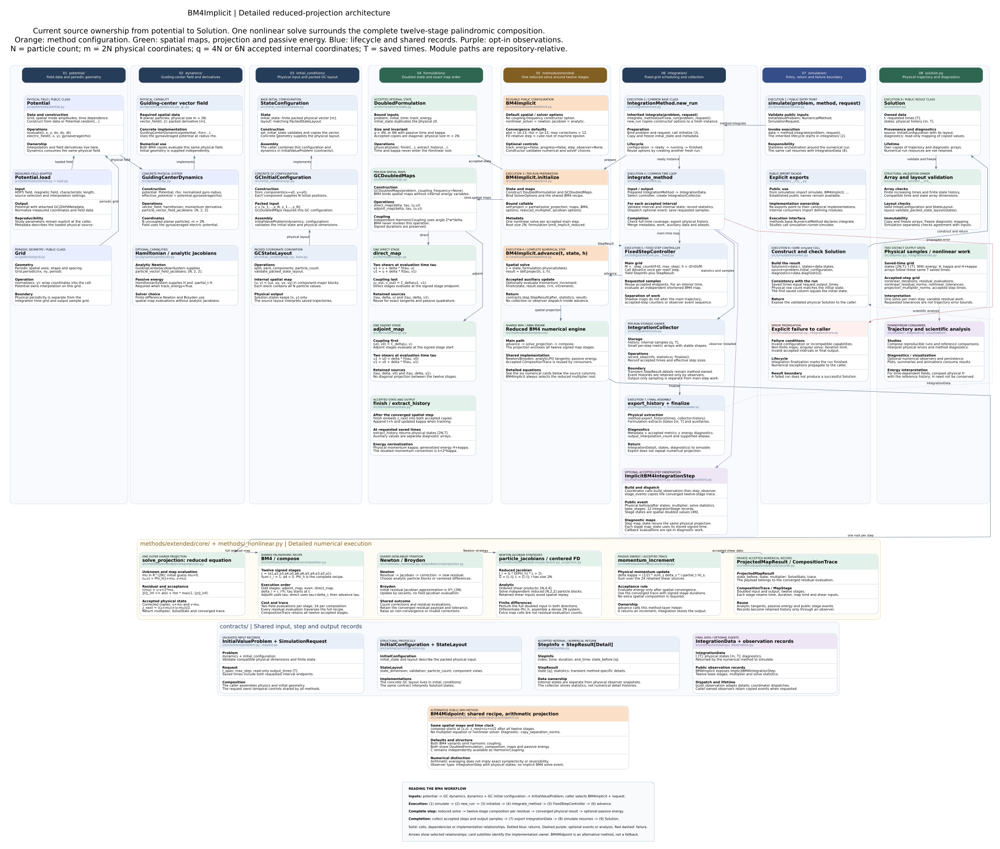
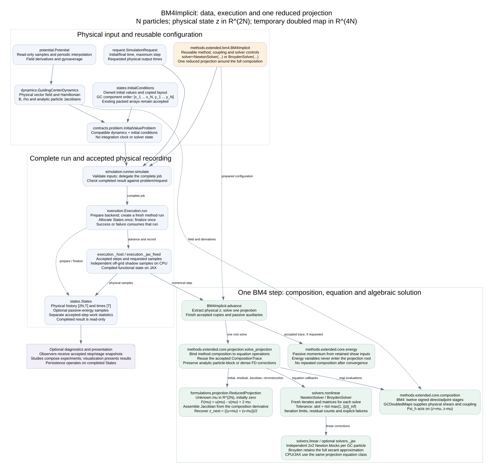

# BM4: detailed execution architecture

Current BM4 advancement is inherited from ProjectedPalindromicMethod in `extended/palindromic.py`. The complete recipe executes explicit A/B/T operations. See [the current operation architecture](../../extended/simulation/palindromic-operations.md).

The linked rendered diagrams and their sources are retained as historical artifacts. Their method-owned integration entry points and former state containers are superseded by the executor-owned lifecycle described in this text.



Open the [SVG](bm4-detailed-architecture.svg) with zoom, the
[PNG](bm4-detailed-architecture.png), or the canonical
[PlantUML/Graphviz source](bm4-detailed-architecture.puml).
This additional diagram follows the style and package ownership of the
[detailed project architecture](../../../simulation/package-integration-architecture.md).
The existing [compact BM4 diagram](bm4-simulation-architecture.md) and historical
diagrams remain available.

The main path describes `BM4Implicit`. The final comparison card describes
`BM4Midpoint` as a separate public method with shared numerical components.
Numbered execution cards and the eight source columns describe the earlier
call sequence and ownership. The numerical band expands the projection,
composition, nonlinear solve, derivatives, passive energy and accepted records.

## One complete implicit step

For N planar particles the accepted state has 2N physical components. Time is scalar; an optional energy observer owns N separate physical momentum entries. The composition prepares two temporary spatial copies with 4N components, then returns a single physical state. Time and momentum never enter a nonlinear root.

`BM4Implicit.initialize` binds `GCDoubledMaps`, the `BM4` composition recipe,
the configured algebraic solver, and the reduced `solve_projection` callable. The inherited
`IntegrationMethod.new_run` owns the fresh run instance and its frozen initial
state and metadata.

Each `advance` extracts the physical state and solves one multiplier equation:

```text
mu starts at zero and has size 2N.
(u, v) = Phi_h(z + mu, z - mu)
r(mu) = u - v + 2*mu
||r(mu)||_inf <= atol + rtol * max(1, ||z||_inf)
z_next = ((u + mu) + (v - mu)) / 2
```

`Phi_h` is the complete twelve-stage composition. Each residual evaluation
traverses all twelve stages; there are no intermediate diagonal projections.
The converged result contains the physical output, multiplier, solver statistics
and the exact trace associated with that accepted residual.

## Composition and solver choices

The signed weights are `(a1,a2,a3,a4,a5,a6,a6,a5,a4,a3,a2,a1)`, with `a4 < 0`.
Their canonical values live in `methods/extended/bm4.py`.
Stages alternate adjoint then direct. For duration `delta`, the adjoint map uses
the stage start time and the direct map its signed endpoint; the stage clock
then advances by `delta`.

The direct map updates the second copy, updates the first using that new second
copy. The adjoint map updates the first and second copies in the reversed
shear order. Neither BM4 variant invokes C. Both
retain two physical shear sources. A complete composition therefore makes
24 vector-field evaluations, before any additional nonlinear iterations or
finite-difference work.

Newton and Broyden solve the same reduced residual:

- Analytic Newton propagates ordered `4 x 4` particle tangents through the
  shears, then solves independent reduced `2 x 2` particle systems.
- Finite-difference Newton differentiates the full doubled spatial map and
  assembles a dense `2N x 2N` reduced system. Those extra spatial map evaluations
  are separate from the recorded residual-evaluation count.
- Broyden starts from `4I` and updates the residual Jacobian approximation by
  secants. It does not evaluate analytic field Jacobians.

The reduced Jacobian is `G D(Phi_h) L + 2I`, where `G = [I,-I]`,
`L = [I;-I]`, and `I` has size `2N`. Solver statistics retain the tolerance used
for acceptance, correction count, residual-evaluation count and final norm.

## Energy, observations and output

After convergence, optional passive quadrature sums the 24 retained signed
shear contributions and divides by two to recover physical `kappa` from the
doubled momentum convention. Energy tracking neither enters the spatial root
nor changes its stopping scale. The method returns one accepted physical vector and optional quadrature data; temporary copies are discarded.

`FixedStepController` owns the main grid. Interior output samples use independent
shortened BM4 maps, which do not change main-step statistics or events.
The host worker in `execution._host` records samples and dispatches an observer only when one is
installed. `ImplicitBM4IntegrationStep` contains the multiplier, physical
before/after states and twelve copied base stages. The base-stage states have
`4N` spatial components; the step snapshots have `2N` physical components.
Constructing these events reuses the accepted trace. Calling their diagnostic
`map_state` functions explicitly performs additional numerical evaluations.

History export produces physical samples `[2N, T]` and saved-time energy arrays.
Nonlinear-work arrays follow accepted main steps. The public `simulate` function
returns the completed `States` and verifies its saved times and initial state.

## BM4Midpoint comparison

| Property | BM4Implicit | BM4Midpoint |
|---|---|---|
| Spatial recipe | Twelve signed stages | Same recipe |
| Projection | Reduced Hairer equation | One arithmetic mean after the recipe |
| Nonlinear unknown | `2N` multiplier entries | None |
| Harmonic coupling | Absent | Absent |
| Additional step metric | Multiplier norm and solve work | Copy-separation norm |
| Observer event | `ImplicitBM4IntegrationStep` | `IntegrationStep` |

Both methods share the state formulation, stage maps, composition and passive
energy implementation. HarmonicCoupling is available independently for future compositions.
Arithmetic averaging alone does not imply exact symplecticity or reversibility.
The model's canonical mathematical reference remains
[theory.tex](../tex/theory.tex) and its [compiled PDF](../tex/theory.pdf).

## Regeneration

Edit `bm4-detailed-architecture.puml`. With Node.js, `@viz-js/viz` and `sharp`
available through normal module resolution or `NODE_PATH`, run from the
repository root:

```bash
node scripts/render_detailed_architecture.cjs docs/models/bm4-implicit/simulation/bm4-detailed-architecture.puml
```

The renderer writes only the matching SVG and PNG. The earlier BM4 and project
diagrams retain their independent sources and renderings.

## Optional JAX execution

This model supports `simulate(..., options=ExecutionOptions(backend="jax", device="cpu"))`
(or a configured `device="gpu"`) with explicit float64. The complete fixed time
loop, particle stages, applicable nonlinear/projection solves and passive energy
quadrature remain on that device until final NumPy `States` export. Its
coefficients, physical-state tolerance scaling and sampling conventions are
unchanged. JAX rejects unconverged solves explicitly. Diagnostics report
`execution_mode="device_resident"`. Python step observers and progress reporting
require the default CPU path.

Import `ExecutionOptions` from `execution.options`. Omission preserves existing
SciPy/NumPy execution. See the [shared execution contract](../../../simulation/jax-execution.md)
for supported physical systems, solver details, timing scope and validation.

## Complete integration executor

`simulate(problem, method, execution=Execution())` delegates the complete
job to `Execution.run`. Import the executor with `from execution import Execution`.
The executor prepares the requested environment and a fresh numerical run, allocates one recorder, invokes the host or compiled worker and finalizes the result once. It owns run status on success and failure. It does not change thread counts, affinity
or global JAX settings. Subclasses can execute the same job elsewhere, while
`simulate` validates the completed `States`. Backend choices remain separate in
`options=ExecutionOptions(...)`. See the [executor contract](../../../simulation/execution.md).
Numerical stages, projection equations and step controllers retain their own
implementations inside this execution boundary. The base class is
`methods.base.IntegrationMethod`; time loops and sampling live inside `execution`,
with no separate integration package.

`Execution_Modal` now implements this boundary for remote NumPy/SciPy CPU
integrations. Results return to the local machine for validation and subsequent
persistence; see the [Modal executor guide](../../../simulation/modal-execution.md).

## Potential evaluation boundary

`Potential.evaluate` uses NumPy/SciPy; `JaxPotential` inherits its representation
and overrides only `evaluate` with JAX. Simulation preparation constructs
`JaxGuidingCenterDynamics` or `JaxFullCyclotronDynamics` from
`dynamics.jax_dynamics`; these subclasses only declare `JaxGCCoordinates` or `JaxFCCoordinates`
and inherit all physical methods. It supplies JAX potentials sharing the existing
splines, including the
gyroaveraged field, without refitting or mutating the source dynamics. Inherited
electric fields follow the potential class; `evaluate_grid` remains NumPy-only. See the
[shared potential contract](../../../dynamics/jax-potential-evaluation.md).

## Initial data and numerical components

The public problem constructor also accepts `states.InitialConditions`; existing
packed-array callers remain supported. See the [component interface](../../../simulation/initial-solvers-formulations.md)
for ownership, array shapes and unchanged request/result boundaries.

BM4 uses `ReducedProjection` for its existing 2N multiplier system and accepts
`solver=NewtonSolver(...)` or `solver=BroydenSolver(...)`. Composition,
physical scaling and the single outer projection remain unchanged.

## Current component diagram

The following model-specific diagram shows the current InitialConditions,
executor-owned lifecycle, ReducedProjection and algebraic solver objects. The
older detailed diagram above remains a historical artifact.



[Diagram source](bm4-components.puml) and [PNG](bm4-components.png).

## State representation and step preparation

`DoubleFormulation(physical_size)` is the only state formulation. It prepares temporary copies through `lift`, `join_copies` and `split_copies`, preserving NumPy/JAX arrays and complete component blocks. Classical, HBVM and adaptive methods use the physical vector directly and instantiate no formulation. The doubled representation stores only a positive physical size; it contains no dynamics, solver or diagnostic state.

Every accepted snapshot is `IntegrationState(time, values)`: scalar time and a physical vector of shape `(d*N,)`. GC remains 2N and FC 4N with or without energy observation. Temporary doubled GC work has 4N entries; generic doubled FC work has 8N. These workspaces never become accepted states. This generic copy support does not extend GC numerical methods to FC.

Execution binds the physical functions and calls `new_run(f, initial_conditions, request, jacobian=..., jacobian_structure=...)`. The method receives no `DynamicalSystem` or problem. `advance(t, Z, h)` returns physical state, statistics, optional details and optional quadrature data. `EnergyObserver` owns its independent momentum and accumulates only accepted quadrature; shadow samples derive from the accepted observer state without committing it. Step callbacks are passed through `simulate(..., observers=(...,))`.

Enable passive energy with `simulate(..., observers=(EnergyObserver(),))`, importing `EnergyObserver` from `diagnostics.methods.energy`. Execution supplies the observer with H and `-partial_t H`. It evaluates saved physical H once and constructs the existing diagnostics. Energy labels and `(N,T)` auxiliary histories remain unchanged; `extended_time` is broadcast from scalar sample times. Old configured Python objects must be recreated; saved numerical archives retain their schemas.

## Integration step

This method owns its positive `step` (default 0.1 in runtime time units).
Complete steps retain that size; only the final accepted step is shortened.
`advance` receives the effective duration without modifying the configured value.
See the [shared scheduling contract](../../../simulation/execution.md#method-owned-integration-step)
for independent output sampling and the common CPU/JAX grid.
