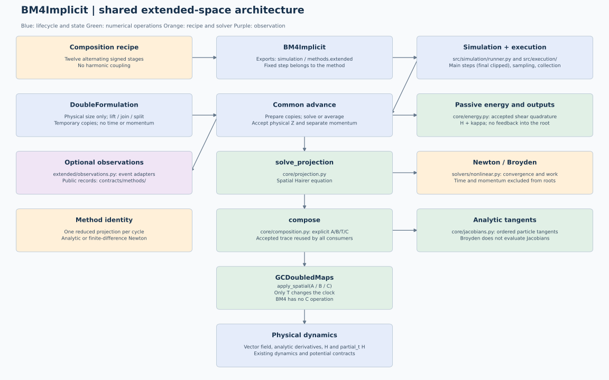

# BM4Implicit: shared extended-space execution

All presets now inherit PalindromicMethod and execute explicit A/B/T operations.
See [palindromic methods and time placement](../../extended/simulation/palindromic-operations.md) for the common classes, generic recipes and independent C.

Both BM4 variants use uncoupled maps and have no coupling-frequency option.
See [uncoupled BM4 and independent C](../../extended/simulation/uncoupled-bm4.md) for migration and historical-data handling.

The compact diagrams describe the current shared numerical execution and executor-owned lifecycle. Older detailed diagrams explicitly marked as historical retain their original ownership conventions.

Twelve alternating signed stages; No harmonic coupling. One reduced projection per cycle; Analytic or finite-difference Newton.

For a package-oriented view with the reduced equation, twelve-stage recipe,
solver strategies and observation records, see the
[detailed BM4 architecture](bm4-detailed-architecture.md)
([SVG](bm4-detailed-architecture.svg), [PlantUML](bm4-detailed-architecture.puml)).
The compact diagram above is retained.

The numerical implementation now lives in `src/methods/extended/`.
Public method names and exports from `simulation` remain unchanged. ABBA6
now uses one outer projection; its observer substeps are unprojected pairs and
its nonlinear-work arrays have one column per accepted step. The former `methods/abba/` and
`methods/bm4/` import adapters have been removed. Internal imports point directly
to the defining modules in `methods.extended`.

See the [shared architecture](../../extended/simulation/extended-simulation-architecture.md)
for the module responsibilities, state layouts, solver equations, energy
normalization and validation contracts. The model's mathematical entry point
remains [theory.tex](../tex/theory.tex), with its compiled
[theory.pdf](../tex/theory.pdf).

## Numerical path

Constructor controls use the typed scalar validators in `methods._validation`,
including rejection of boolean tolerances. Neither BM4 constructor accepts a coupling frequency. Shared
Newton/Broyden input and cached-residual checks live in `solvers.nonlinear`;
they preserve ownership of the initial arrays and do not add residual evaluations.
Numerical convergence and singularity guards remain in their solve loops.

Initialization binds this model's recipe and options. The ordinary implicit
path is `advance -> solve_projection -> compose -> A/B/T/C operations`.
Explicit midpoint methods use `midpoint_step` in place of the nonlinear
projection. ABBA4 and ABBA6 both project once around the complete
unprojected composition; their recipes contain six and fourteen stages.

One reduced Hairer equation surrounds the complete twelve-stage cycle.
Newton retains analytic and finite-difference strategies; Broyden uses the same
reduced equation without analytic Jacobians.

The shared composition keeps signed durations and the nonautonomous stage
clock: adjoint maps evaluate at the start of their substep and direct maps at
its end. ABBA uses no harmonic coupling. Both BM4 variants also use no harmonic coupling; C remains available independently through HarmonicCoupling.

## Accepted states and diagnostics

For N planar particles, both methods use two spatial copies with 4N components.
Optional passive energy adds N time entries and N physical momenta, producing
6N accepted internal components. Physical outputs and observer snapshots remain
2N dimensional. Time and momentum never enter a nonlinear root.

The accepted shear trace feeds common normalized momentum quadrature after the
spatial computation. The diagnostic `H + kappa - H_initial` measures energy
balance for the time-dependent Hamiltonian. Tracking does not alter the spatial
map or its nonlinear stopping scale. Analytic tangents and BM4 stage events reuse
the retained spatial stages; no extra spatial replay is required for them.

The integration coordinator still owns accepted intervals, off-grid output
sampling, history collection and observer dispatch. Energy arrays follow saved
times and nonlinear-work arrays follow accepted main steps. Existing method
and observer tests remain applicable, supplemented by
`tests/test_extended_family.py`.

## Diagram maintenance

Regenerate this diagram and the shared family view with
`python scripts/render_extended_architecture.py`. The script writes the
PlantUML/Graphviz source and corresponding SVG/PNG views from the same graph
specification. Historical files marked `old` or `proposed` are archival diagrams;
the figure above describes the current implementation.

## Complete integration executor

`simulate(problem, method, request, execution=Execution())` delegates the complete
job to `Execution.run`. Import the executor with `from execution import Execution`.
The executor prepares the requested environment and a fresh numerical run, allocates one recorder, invokes the host or compiled worker and finalizes the result once. It owns run status on success and failure. It does not change thread counts, affinity
or global JAX settings. Subclasses can execute the same job elsewhere, while
`simulate` validates the completed `States`. Backend choices remain separate in
`options=ExecutionOptions(...)`. See the [executor contract](../../../simulation/execution.md).
Numerical stages, projection equations and step controllers retain their own
implementations inside this execution boundary. The base class is
`methods.base.IntegrationMethod`; time loops and sampling live inside `execution`,
with no separate integration package.

`Execution_Modal` implements this boundary for remote NumPy/SciPy or JAX CPU
integrations. Results return to the local machine for validation and subsequent
persistence; see the [Modal executor guide](../../../simulation/modal-execution.md).

The matched Poincare star study selects this canonical implementation with
`studies.poincare_rho_sweep.RhoStarConfig(method="BM4Implicit", ...)`.
It applies one reduced projection around every complete composition, with explicit
analytic-Newton controls shared with GaussLegendre4: absolute tolerance `1e-12`,
relative tolerance `1e-11`, at most 40 corrections and Jacobian relative step
`cbrt(eps)`. These study defaults do not change the method's constructor defaults.
The study accepts JAX CPU float64 and retains the initial state and integer-cycle
returns, scalar solver metadata, and optional folded coordinates. Full per-step
diagnostic arrays are excluded from these cycle-only archives. The field, geometry
and radial Hamiltonian normalization remain the same across methods; no independent
trajectory-accuracy reference is inferred from a successful integration.
The radial Poincare study also supports explicit additional initial positions via
`studies.poincare_gap_probes.GapProbeSeeds` and `prepare_gap_probes`. These use
the same canonical method, physical dynamics, complete-step grid and JAX/Modal
execution as the original star. Probe archives retain their own seed geometry
and IDs and are saved separately; viewers append their coordinates after checking
the field fingerprint, scientific settings and aligned cycle times. The eight
gap probes have IDs 41–48, with two positions per gap selected at rho=0.30 and
reused for all eleven rho values. See the
[batch and persistence protocol](../../../simulation/modal-execution.md#additional-particles-inside-saved-poincare-gaps).

## Initial-state ownership

`InitialValueProblem(dynamics, initial_state, layout=...)` captures a validated
physical array, particle count and independent layout. Later edits to the input
array do not change the prepared formulation. Physical layouts belong to
`formulations.layout`; compatible structural layouts require no inheritance. Built-in dynamics keep their physical parameters
immutable. See the shared [layout and ownership contract](../../../dynamics/protocols.md#physical-layouts-and-problem-ownership).

## Newton iterate callbacks

The keyword-only `newton_observer` receives independent read-only
`contracts.solvers.nonlinear.NewtonIteration` snapshots, including the physical
projection multiplier. It observes already computed residuals and supports
independent or nested runs without global instrumentation. Direct advances and
off-grid output solves emit iterates; diagnostic `map_state` replay does not.
Broyden, compiled JAX, and remote Modal execution reject this optional Python
callback. See the [shared callback and particle-solve contract](../../extended/simulation/extended-simulation-architecture.md#explicit-newton-iteration-observation).

### Shared comparison records

The three-, four-, and five-method comparison campaigns share method construction,
alignment checks, and metric reductions in `studies._comparison`; their public
study entry points remain unchanged. Reference, accuracy, summary, and execution
records belong to `contracts.studies.comparison`, and CSV readers reconstruct those same
record types without importing study orchestration. Energy-bound and parallel
BM4 archive records belong to `contracts.studies`, with explicit re-exports
from their established study modules. See the
[record ownership contract](../../../simulation/integration-architecture.md#comparison-and-archive-record-ownership).

## Compiled fixed-step contract

Fixed-step methods inherit `IntegrationMethod` and declare `jax_mode="device_resident"`.
The executor resolves the device and prepares the dynamics; a numerical family
adapter binds the method's controls into `contracts.methods.compiled.CompiledStep`.
The executor starts the shared `execution/_jax_fixed.py` loop, which knows no
concrete numerical method. Each method retains its compiled stages and statistics.
See [JAX execution](../../../simulation/jax-execution.md).

## Potential evaluation boundary

`Potential.evaluate` uses NumPy/SciPy; `JaxPotential` inherits its representation
and overrides only `evaluate` with JAX. Simulation preparation binds the shared
GC/FC equations to JAX potentials sharing the existing splines, including the
gyroaveraged field, without refitting or mutating the source dynamics. Inherited
electric fields follow the potential class; `evaluate_grid` remains NumPy-only. See the
[shared potential contract](../../../dynamics/jax-potential-evaluation.md).

Initial data are packed NumPy arrays, including the output of `states.generators`. `formulations.layout` supplies GC/FC layouts; `request.SimulationRequest` owns the initial time and output schedule. Controllers manage the current internal `IntegrationState`; `states.States` stores physical samples and becomes the completed result. Several methods can share a formulation. See the [migration guide](../../../simulation/api-migration.md).

## Initial data and numerical components

The public problem constructor also accepts `states.InitialConditions`; existing
packed-array callers remain supported. See the [component interface](../../../simulation/initial-solvers-formulations.md)
for ownership, array shapes and unchanged request/result boundaries.

BM4 uses `ReducedProjection` for its existing 2N multiplier system and accepts
`solver=NewtonSolver(...)` or `solver=BroydenSolver(...)`. Composition,
physical scaling and the single outer projection remain unchanged.
