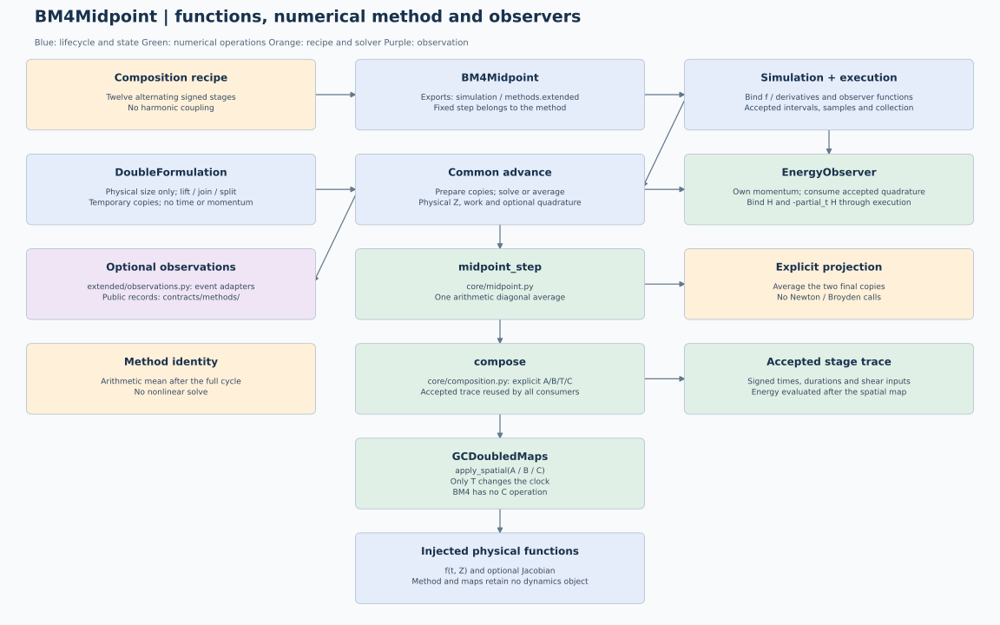

# BM4Midpoint: shared extended-space execution

All presets now inherit PalindromicMethod and execute explicit A/B/T operations.
See [palindromic methods and time placement](../../extended/simulation/palindromic-operations.md) for the common classes, generic recipes and independent C.

Both BM4 variants use uncoupled maps and have no coupling-frequency option.
See [uncoupled BM4 and independent C](../../extended/simulation/uncoupled-bm4.md) for migration and historical-data handling.

The compact diagrams describe the current shared numerical execution and executor-owned lifecycle. Older detailed diagrams explicitly marked as historical retain their original ownership conventions.

Twelve alternating signed stages; No harmonic coupling. Arithmetic mean after the full cycle; No nonlinear solve.

The numerical implementation now lives in `src/methods/extended/`.
Public method names and exports from `simulation` remain unchanged. ABBA6
now uses one outer projection; its observer substeps are unprojected pairs and
its nonlinear-work arrays have one column per accepted step. The former `methods/abba/` and
`methods/bm4/` import adapters have been removed. Internal imports point directly
to the defining modules in `methods.extended`.

See the [shared architecture](../../extended/simulation/extended-simulation-architecture.md)
for the module responsibilities, state layouts, solver equations, energy
normalization and validation contracts. The model's mathematical entry point
remains [theory.tex](../tex/theory.tex), with its compiled
[theory.pdf](../tex/theory.pdf).

## Numerical path

BM4Midpoint has no coupling-frequency option. State-extension validation stays in
`methods.extended.configuration`; stage-state checks stay with the composed map.

Initialization binds this model's recipe and options. The ordinary implicit
path is `advance -> solve_projection -> compose -> A/B/T/C operations`.
Explicit midpoint methods use `midpoint_step` in place of the nonlinear
projection. ABBA4 and ABBA6 both project once around the complete
unprojected composition; their recipes contain six and fourteen stages.

The arithmetic projection averages the two copies once after the complete
recipe. It has no nonlinear solver and does not imply exact symplecticity or
reversibility.

The shared composition keeps signed durations and the nonautonomous stage
clock: adjoint maps evaluate at the start of their substep and direct maps at
its end. ABBA uses no harmonic coupling. Both BM4 variants also use no harmonic coupling; C remains available independently through HarmonicCoupling.

## Accepted states and diagnostics

For N planar particles the accepted state has 2N physical components. Time is scalar; an optional energy observer owns N separate physical momentum entries. The composition prepares two temporary spatial copies with 4N components, then returns a single physical state. Time and momentum never enter a nonlinear root.

The accepted shear trace feeds common normalized momentum quadrature after the
spatial computation. The diagnostic `H + kappa - H_initial` measures energy
balance for the time-dependent Hamiltonian. Tracking does not alter the spatial
map or its nonlinear stopping scale. Analytic tangents and BM4 stage events reuse
the retained spatial stages; no extra spatial replay is required for them.

The integration coordinator still owns accepted intervals, off-grid output
sampling, history collection and observer dispatch. Energy arrays follow saved
times and nonlinear-work arrays follow accepted main steps. Existing method
and observer tests remain applicable, supplemented by
`tests/test_extended_family.py`.

## Diagram maintenance

Regenerate this diagram and the shared family view with
`python scripts/render_extended_architecture.py`. The script writes the
PlantUML/Graphviz source and corresponding SVG/PNG views from the same graph
specification. Historical files marked `old` or `proposed` are archival diagrams;
the figure above describes the current implementation.

## Optional JAX execution

This model supports `simulate(..., options=ExecutionOptions(backend="jax", device="cpu"))`
(or a configured `device="gpu"`) with explicit float64. The complete fixed time
loop, particle stages, applicable nonlinear/projection solves and passive energy
quadrature remain on that device until final NumPy `States` export. Its
coefficients, physical-state tolerance scaling and sampling conventions are
unchanged. JAX rejects unconverged solves explicitly. Diagnostics report
`execution_mode="device_resident"`. Python step observers and progress reporting
require the default CPU path.

Import `ExecutionOptions` from `execution.options`. Omission preserves existing
SciPy/NumPy execution. See the [shared execution contract](../../../simulation/jax-execution.md)
for supported physical systems, solver details, timing scope and validation.

## Dimensional HDF5 star calculation

The local calculation notebook at
`notebooks/developements/poincare_section/bm4_midpoint_jax_star/calculation.ipynb`
uses `studies.poincare_star.PoincareStarConfig` and `run_poincare_star` to compose
the existing dimensional HDF5 field with BM4Midpoint and JAX. The generic
`states.generators.radial_star` constructor places equally spaced
particles on equally spaced straight arms, excluding repeated center points.
Its canonical import is from `states.generators`.

The example has eight arms of 16 particles, each extending 40% of the source
cell width from its center. Coordinates remain in meters; time is `tau=t/T0`.
The established `rho_hat=0.3` is converted to meters using `lambda/(2*pi)`.
Five forcing cycles at 40 steps per cycle produce 200 complete steps and six
saved states, including initialization. The default destination preserves the
notebook hierarchy in the configured bucket. The paired `visualisation.ipynb`
loads that canonical archive without integration and exports `poincare_star.html`.
It uses `visualization.poincare_star` and the shared comparison viewer for fixed
initial positions, animated once-per-cycle returns, arm/particle selection and
synchronized zoom/panning. Axes remain in meters; optional periodic folding
changes only display copies, never the saved physical coordinates.

## Complete integration executor

`simulate(problem, method, request, execution=Execution())` delegates the complete
job to `Execution.run`. Import the executor with `from execution import Execution`.
The executor prepares the requested environment and a fresh numerical run, allocates one recorder, invokes the host or compiled worker and finalizes the result once. It owns run status on success and failure. It does not change thread counts, affinity
or global JAX settings. Subclasses can execute the same job elsewhere, while
`simulate` validates the completed `States`. Backend choices remain separate in
`options=ExecutionOptions(...)`. See the [executor contract](../../../simulation/execution.md).
Numerical stages, projection equations and step controllers retain their own
implementations inside this execution boundary. The base class is
`methods.base.IntegrationMethod`; time loops and sampling live inside `execution`,
with no separate integration package.

`Execution_Modal` now implements this boundary for remote NumPy/SciPy and JAX CPU
integrations. Results return to the local machine for validation and subsequent
persistence; see the [Modal executor guide](../../../simulation/modal-execution.md).

## Modal JAX CPU star study

The local development study
`notebooks/developements/poincare_section/modal_jax_bm4midpoint_star_48_10_cycles_50_steps/`
uses the canonical `BM4Midpoint` through `simulation.runner.simulate` and
`Execution_Modal`. The reusable composition is `studies.modal_cpu_comparison`;
resource settings belong to `examples/modal_jax_cpu_app.py`.
It compares JAX float64 on CPU allocations of 1, 2 and 4 cores with identical
48-particle inputs: eight arms, six inclusive radii from 0.05 to 0.35 of the
cell radius R=L/2, centered in the periodic cell, first arm along +x. The generic
`states.generators.radial_star` accepts an optional `inner_radius`; its
existing default spacing is unchanged.

The field is reconstructed from the verified PHI_2 HDF5 data with B=1.5,
characteristic length 0.06, variable source selection (15,) with constant field 0, cubic interpolation,
rho=0.3 and coupling frequency pi/8. Ten forcing cycles at 50 complete steps
per cycle give h=0.02, 500 steps and 501 aligned states. BM4Midpoint uses an
arithmetic-mean projection and no Newton solve. Each worker runs one first
integration and three warm repetitions; metadata records timings, hardware
and cross-CPU trajectory discrepancies. The paired visualization notebook
only loads saved bucket archives and plots their integer-cycle sections.
This is a short resource-scaling experiment with no independent accuracy
reference. See the [Modal execution guide](../../../simulation/modal-execution.md)
for deployment, transport recovery and persistence behavior.

## Local JAX long-time star study

`studies.local_jax_star` prepares the same verified HDF5 physics for a local
`Execution` with JAX CPU float64. Its matched manual-run notebooks are under
`notebooks/developements/poincare_section/local_jax_bm4midpoint_star_41_5000_cycles_50_steps/`.
They specify one shared central particle and five particles per arm on eight
arms, at positive radii (0.14, 0.28, 0.42, 0.56, 0.70) R with R=L/2: 41
particles in total. The canonical geometry factory `radial_star` now accepts
`include_center=True`, which prepends one central particle and preserves the
existing arm-major order. Its default remains center-free.

The local study performs 5000 forcing cycles at 50 complete steps per cycle,
retaining all 250001 states. Consecutive 50-cycle blocks continue from the
previous accepted physical state at absolute time. This is valid for the
arithmetic-projected BM4Midpoint map with energy tracking disabled: both
each step returns a single accepted physical state, and there is no nonlinear
solver history to preserve. Execution caches the prepared JAX dynamics and their function bindings.
The block schedule is recorded because floating-point time evaluation can
differ from one uninterrupted compiled loop; no bitwise long-time equivalence
is claimed. The study checks every block's step count, aligned output,
arithmetic projection and absence of nonlinear unknowns.

`diagnostics.execution.run_progress.progress_log` writes flushed timestamped messages to
the notebook and a local log file. It records completed cycles, percentage,
block wall time, elapsed time and an estimated remaining time. A separate
heartbeat thread reports during compilation, integration and upload, without
calling Python observers inside JAX. Errors and interrupts retain tracebacks
and propagate. `COMPLETED AND SAVED` follows successful publication only.
Progress blocks are not restart checkpoints. The numerical result returns
locally and is then saved to the configured bucket; failed uploads retain the
ordinary persistence recovery archive and are reported as failures.

`studies.h5_provenance.prepare_verified_h5_field` is shared with the Modal CPU
comparison; the existing `prepare_cpu_star` name remains its supported study
facade. `visualization.local_jax_star` reads saved states to plot initial
geometry and block timings and export every integer-cycle return. This study
does not extrapolate a short accuracy reference or certify 5000-cycle accuracy.

## Dimensional 40-particle rho sweep on Modal

`studies.poincare_rho_sweep` assembles 40 particles at distinct, linearly spaced
radii from zero to 0.85 times the half-width of the original HDF5 cell. Particle
IDs increase with radius. `states.generators.ranked_radial_star` assigns
successive radial ranks to alternating arms, with eight arms and five assigned
particles per arm. The first particle is the only particle at the center.

The local working experiment lives at
`notebooks/developements/poincare_section/bm4_midpoint_star_40_rho_sweep/`.
Its eleven `calculation_rho_*.ipynb` files specify rho from 0 to 0.5 in increments
of 0.05. Each independently configures 5000 forcing cycles, 50 complete steps
per cycle, arithmetic midpoint projection, no energy tracking, and zero coupling
frequency. The initial state and the 5000 integer-cycle returns are saved;
internal-step arrays are omitted from the published archive.

Coordinates remain in meters, without spatial normalization or output wrapping.
`load_dimensional_h5_field` supplies the stream function `(T0/B)*Phi`, so time
alone is normalized by the forcing period. The sweep parameter is the usual
dimensionless gyro-radius: `rho_m = rho_hat * characteristic_length / (2*pi)`.
At characteristic length 0.06 m, rho=0.30 corresponds to 0.00286478898 m.
The notebooks explicitly select B=1.5, variable source field `(15,)` with constant field 0, cubic
interpolation, the checked HDF5 source hash, and the complete numerical settings.

Deploy `examples/modal_poincare_rho_app.py` to create the authenticated
`gc2d-poincare-rho-sweep/integrate` endpoint. It uses JAX CPU float64, a two-core
request and limit, 2048/4096 MiB memory, a 7200-second timeout, no configured
retries, and at most ten independent containers (one integration per container).
Each running container receives two CPU cores; ten concurrent runs therefore
request twenty cores in total. Worker start/finish timestamps are retained as
scalar diagnostics to verify integration overlap. `Execution_Modal` retains a call receipt;
`modal_rho_executor` reuses a unique confirmed receipt on interruption. A
completed compatible archive is loaded rather than calculated again. Scientific
results are published to the bucket through `solution_destination`, with the
same experiment hierarchy and a separate `rho_0_30_v1`-style run ID per rho.

`visualisation.ipynb` loads and verifies only completed archives and calls
`visualization.poincare_rho_sweep.export_rho_sweep`. The shared comparison viewer
retains animation, interval sliders, accumulation, particle selection, point
size, zoom and pan, and adds a rho selector with incomplete runs disabled.
Particle labels and colors follow initial radial rank. Both the fixed initial
star and animated returns are displayed in meters, without coordinate wrapping.
The original cell is the initial viewport; Full view includes all unwrapped
returns. This experiment does not certify long-time trajectory accuracy.

### Standard phase-field and return display

For new or revised viewers, pass the original HDF5 `source` to
`export_rho_sweep`. The exporter rebuilds the archived physical configuration,
checks its source hash, and uses `studies.poincare_rho_sweep.sample_rho_dynamics`
to evaluate the effective gyroaveraged Hamiltonian and GC vector field without
integrating any trajectories. The left panel provides potential and arrow
layers with an independent 51-frame phase control (steps 0–50). Both forcing
endpoints are evaluated and checked before exact browser closure. Potential
colors and arrow lengths retain fixed scales across the phases of a given rho.
The rho selector updates both fields. In cell fractions, the display transforms
H to H/L² and velocity to v/L, preserving the Hamiltonian-vector-field relation.

On the right, unfilled particle-colored circles mark the saved positions at
Start cycle; cycle zero selects the original initial state. Subsequent returns
and the current return retain their existing displays. Selection, start cycle
and rho changes all update the rings. The shared panel exporter supports an
explicit `first_cycle=0` for archives containing the initial state; its default
remains one for existing return-only comparisons. Legacy calls without a source
retain their static context panel. The radial-potential star visualization
notebooks now explicitly select the standard field panel.

### Folded display and saved returns

The independent experiment at
`notebooks/developements/poincare_section/bm4_midpoint_star_40_rho_0_30_folded/`
contains matched `calculation.ipynb` and `visualisation.ipynb` notebooks. It
retains the dimensional star's physical inputs, 40 particles, eight arms,
5000 forcing cycles, 50 complete steps per cycle and zero coupling. Only
rho=0.30 is configured, using JAX CPU float64 on the same Modal endpoint.

`run_and_save_rho_star(..., save_folded_returns=True)` preserves unwrapped
cycle states and additionally archives `cycle_positions_wrapped` in runtime
units and `cycle_positions_cell_fraction` relative to the cell origin.
These diagnostic arrays have shape `(5001, 40, 2)`, including cycle zero;
they are computed after integration, never fed back into the solver.
`studies.poincare_rho_sweep.folded_rho_positions` defines the shared conversion.
The default archive behavior remains unchanged for existing experiments.

`export_rho_sweep(..., fold_to_cell=True)` displays the initial star and
cycle returns in the unit cell using `((X-X0) modulo L)/L`. Field evaluation
was already periodic; this option changes only display coordinates. The
calculation publishes an independent NPZ/JSON archive under the matching
experiment bucket prefix. The visualization downloads that archive without
submitting a calculation. No reference integration is included because this
experiment repeats the star study with different saved/display representations.

### Star repeat with the historical radial Hamiltonian

`RhoStarConfig.hamiltonian_convention="radial"` multiplies the dimensional
star stream `(T0/B)*Phi` by `1/(2*pi)`, including both mean and oscillating
samples. Frequencies and cycle times are unchanged. After conversion to
`q=2*pi*(X-X0)/lambda`, this stream equals the historical radial study's
canonical `Phi_hat`. It changes the drift relative to the forcing; it is
independent of spatial normalization and periodic display folding.
The default `"cycle_time"` retains the previous star dynamics. Archives
without this setting are interpreted as `"cycle_time"`; the two conventions
cannot share a completed destination or a rho comparison viewer.

The independent calculation/visualisation pair is under
`notebooks/developements/poincare_section/bm4_midpoint_star_40_rho_0_30_folded_radial_potential/`.
It retains the previous folded star's 40 particles, eight arms, rho=0.30,
5000 cycles, 50 steps per cycle and zero coupling, using JAX CPU on Modal.
The notebooks explicitly select the radial convention and use an independent
bucket prefix and call receipts. Unwrapped meter coordinates and both folded
cycle representations are saved. The viewer identifies the Hamiltonian
convention alongside the step and coupling settings.

The radial-Hamiltonian folder also contains independent matched
`calculation_rho_*.ipynb` / `visualisation_rho_*.ipynb` pairs for the remaining
rho values from 0.00 to 0.50 in increments of 0.05. The original
`calculation.ipynb` remains the rho=0.30 calculation. Completed archives are
reused; missing calculations can run concurrently in independent notebook
kernels against the ten-container Modal deployment. Every rho has its own
bucket run prefix and submission receipts. The main `visualisation.ipynb`
loads all completed values into a single folded viewer with a rho selector.

### Spatially normalized repeat

HDF5 filtering is controlled by `Potential.load(..., sigma=None)`: `None`
disables smoothing, while a finite non-negative width enables Gaussian filtering
in grid samples. The separate `denoising` argument has been removed.

The HDF5 loader preserves physical coordinates and amplitudes by default.
`load_dimensional_h5_field` constructs the cycle-time Hamiltonian `(T0/B)*Phi`
directly from these samples, using B in `GuidingCenterDynamics`. The study's
`RhoStarConfig.spatial_normalization` remains a separate choice. The original
rho sweep and folded radial study continue integrating unwrapped meter
coordinates. Their 0.18 m square corresponds to a `6*pi` square at characteristic
length 0.06 m; folding into `[0,1)` remains postprocessing. The radial convention
retains its additional `1/(2*pi)` amplitude factor and its original forcing
period, preserving historical viewer dynamics.

`RhoStarConfig.spatial_normalization="characteristic_length"` repeats the same
physical experiment with `q = s*(X-X0)`, `s = 2*pi/characteristic_length`, where
`X0` is the lower corner of the measured cell. The default remains `"none"`
for existing dimensional notebooks and archives. The normalized working copy
is `notebooks/developements/poincare_section/bm4_midpoint_star_40_rho_sweep_normalized_space/`;
generate it with `scripts/create_poincare_rho_sweep_notebooks.py
--spatial-normalization characteristic_length`. It has its own bucket prefix
and Modal receipts, eleven independent calculation notebooks, and a viewer.

The normalized potential uses the same samples, interpolation order and
frequencies, with stream function `H_q = s^2*(T0/B)*Phi`. This square factor
ensures `dq/dtau = s*dX/dtau` at unchanged `tau=t/T0`; equivalently this stream
equals `2*pi*Phi_hat` from the canonical H5 loader. Merely loading `Phi_hat`
would alter the drift speed relative to the forcing in this particular repeat.
The runtime gyro-radius is `rho_hat`, while its physical radius remains
`rho_hat*characteristic_length/(2*pi)` meters. The cell width is approximately
`6*pi`, not one, for the measured 0.18 m cell and 0.06 m characteristic length.

Initial conditions, integration and stored states all use these dimensionless
coordinates. Metadata retains both physical geometry and runtime geometry,
including the scale and origin needed to invert the coordinate change. The
viewer uses saved coordinates directly and labels its axes `R_hat`, `Z_hat`;
its particle labels also retain physical initial radii for comparison. Archives
with different spatial normalizations cannot share a destination or a viewer.
Short trajectory tests verify coordinate equivalence and agreement between the
SciPy and JAX execution paths; chaotic long-time runs need not agree bitwise.

### Radial repeat with cycle-time normalization

`notebooks/developements/poincare_section/bm4_midpoint_48_radial_5000_cycles_20_steps_cycle_time/`
contains an independent `calculation.ipynb` / `visualisation.ipynb` pair. It
retains the historical 48-particle radial study's physical inputs, radial
fractions from 0 to 0.49 of the cell width, rho=0.3, 5,000 forcing cycles,
20 complete steps per cycle and coupling frequency pi/8. It changes the
stream function to `H = 2*pi*Phi_hat` at unchanged `tau=t/T0`, multiplying
both the mean and oscillating arrays while retaining their frequencies.

`studies.poincare_radial_cycle_time` verifies the original metadata against
its completion manifest and verifies the HDF5 source hash. It reconstructs
the initial positions from the archived radial geometry and preserves IDs
and colors. It uses the current BM4Midpoint implementation with a single
joint local integration (JAX CPU float64 by default), rather than the old
frozen AWS implementation and 16-worker partition. Thus this is a scientific
repeat, not a bitwise reproduction of that historical runtime.

All complete-step states, copy-separation diagnostics, the scaled potential
and provenance are persisted with `diagnostics.io.persistence` in the default
bucket under the new experiment hierarchy. Compatible completed archives
are reused; changed scientific inputs require a different run ID. The
visualisation notebook loads the same destination without integrating.
`visualization.poincare_radial_cycle_time` extracts integer-cycle returns,
wraps them into the cell and divides by the cell width for B-style plots and
an offline particle selector. The diagnostic is the copy-separation infinity
norm across all particles, rather than one norm per historical worker.
No independent long-time trajectory-accuracy certification is implied.

`studies.poincare_rho_sweep.RhoStarConfig` also supports matched BM4Implicit,
RK4 and GaussLegendre4 star studies. Its default `method="BM4Midpoint"` keeps
the existing arithmetic-mean projection and cycle-only archive contract.
Previously saved configurations without method or Newton fields retain these
defaults when reloaded; a different method or scientific configuration cannot
reuse the same completed destination.
The radial Poincare study also supports explicit additional initial positions via
`studies.poincare_gap_probes.GapProbeSeeds` and `prepare_gap_probes`. These use
the same canonical method, physical dynamics, complete-step grid and JAX/Modal
execution as the original star. Probe archives retain their own seed geometry
and IDs and are saved separately; viewers append their coordinates after checking
the field fingerprint, scientific settings and aligned cycle times. The eight
gap probes have IDs 41–48, with two positions per gap selected at rho=0.30 and
reused for all eleven rho values. See the
[batch and persistence protocol](../../../simulation/modal-execution.md#additional-particles-inside-saved-poincare-gaps).

## Initial-state ownership

Dynamics declare `GCCoordinates()` for fixed `(x, y)` blocks or `FCCoordinates()` for fixed `(x, y, vx, vy)` blocks, from `dynamics.coordinates`. `PhysicalCoordinates` is a stateless base with common array operations; dimensions are fixed properties and no names or role-index fields are configured. `split()` returns an ordinary tuple. `JaxGCCoordinates` and `JaxFCCoordinates`, from `dynamics.jax_coordinates`, inherit their respective operations and only select `jnp` through `array_namespace`.

`InitialValueProblem` takes the dynamics declaration or requires an explicit layout. It never infers a model from dimension. `StateLayout.snapshot()` explicitly supplies an immutable NumPy convention; `describe_coordinates` validates that snapshot and its dimension. Compatibility compares the snapshot class and equality, even for equally sized arrays. Initial conditions and results own their arrays and conventions without retaining live dynamics or a potential. Custom conventions derive from `PhysicalCoordinates` and implement fixed operations instead of role tables; external adapters may supply these snapshots without inheritance. Packing and views preserve `(d*N,*samples)`, `(d,N,*samples)` and `(N,*samples)`. The respective JAX classes support tracing; incomplete blocks are rejected.

Built-in dynamics keep physical parameters immutable. A new problem is required for revised initial values. Saved numerical archives retain existing GC/FC schemas and can be interpreted without constructing dynamics or loading a field.

## Compiled fixed-step contract

Fixed-step methods use the same `advance` implementation with NumPy or JAX
arrays. They contain no JAX imports, backend declaration or alternate stages.
Execution owns compatibility checks and device selection; `execution._jax_step`
binds an isolated prepared method to `contracts.methods.compiled.CompiledStep`.
Potential, dynamics and solvers own their internal `_as_jax()` preparation.
The shared `execution/_jax_fixed.py` loop handles scheduling and sampling.
See [JAX execution](../../../simulation/jax-execution.md).

HDF5 variable-field indices refer directly to the original file; no amplitude
ranking is applied. The first source frequency must be exactly zero and every
selected variable frequency must be finite and positive. `Potential.load`
uses source cyclic frequencies directly. Optional temporal rescaling uses the
first selected mode as reference; archived study reconstructions use their
recorded characteristic period explicitly outside the loader. See the shared
[HDF5 contract](../../../dynamics/gc2d-h5-import.md) for selection and archive
migration, including recovery from recorded original source indices.

The physical loader uses `T=1/f_ref`, with public cyclic frequencies and phase
`exp(i*2*pi*f*t)`. Historical dimensional and radial studies retain the recorded
clock `T0=2*pi/f_ref`. Their radial Hamiltonian equals the corrected physical-cycle
Hamiltonian as a function of cycle index, but stored legacy seconds are not
relabeled. New study provenance marks `time_convention="legacy_cycles"`.

## Potential evaluation boundary

`Potential.evaluate` uses NumPy/SciPy; `JaxPotential` inherits its representation
and overrides only `evaluate` with JAX. Simulation preparation constructs
`JaxGuidingCenterDynamics` or `JaxFullCyclotronDynamics` from
`dynamics.jax_dynamics`; these subclasses only declare `JaxGCCoordinates` or `JaxFCCoordinates`
and inherit all physical methods. It supplies JAX potentials sharing the existing
splines, including the
gyroaveraged field, without refitting or mutating the source dynamics. Inherited
electric fields follow the potential class; `evaluate_grid` remains NumPy-only. See the
[shared potential contract](../../../dynamics/jax-potential-evaluation.md).

Dynamics declare `GCCoordinates()` for fixed `(x, y)` blocks or `FCCoordinates()` for fixed `(x, y, vx, vy)` blocks, from `dynamics.coordinates`. `PhysicalCoordinates` is a stateless base with common array operations; dimensions are fixed properties and no names or role-index fields are configured. `split()` returns an ordinary tuple. `JaxGCCoordinates` and `JaxFCCoordinates`, from `dynamics.jax_coordinates`, inherit their respective operations and only select `jnp` through `array_namespace`.

## Initial data and numerical components

The public problem constructor also accepts `states.InitialConditions`; existing
packed-array callers remain supported. See the [component interface](../../../simulation/initial-solvers-formulations.md)
for ownership, array shapes and unchanged request/result boundaries.

## State representation and step preparation

`DoubleFormulation(physical_size)` is the only state formulation. It prepares temporary copies through `lift`, `join_copies` and `split_copies`, preserving NumPy/JAX arrays and complete component blocks. Classical, HBVM and adaptive methods use the physical vector directly and instantiate no formulation. The doubled representation stores only a positive physical size; it contains no dynamics, solver or diagnostic state.

Every accepted snapshot is `IntegrationState(time, values)`: scalar time and a physical vector of shape `(d*N,)`. GC remains 2N and FC 4N with or without energy observation. Temporary doubled GC work has 4N entries; generic doubled FC work has 8N. These workspaces never become accepted states. This generic copy support does not extend GC numerical methods to FC.

Execution binds the physical functions and calls `new_run(f, initial_conditions, request, jacobian=..., jacobian_structure=...)`. The method receives no `DynamicalSystem` or problem. `advance(t, Z, h)` returns physical state, statistics, optional details and optional quadrature data. `EnergyObserver` owns its independent momentum and accumulates only accepted quadrature; shadow samples derive from the accepted observer state without committing it. Step callbacks are passed through `simulate(..., observers=(...,))`.

Enable passive energy with `simulate(..., observers=(EnergyObserver(),))`, importing `EnergyObserver` from `diagnostics.methods.energy`. Execution supplies the observer with H and `-partial_t H`. It evaluates saved physical H once and constructs the existing diagnostics. Energy labels and `(N,T)` auxiliary histories remain unchanged; `extended_time` is broadcast from scalar sample times. Old configured Python objects must be recreated; saved numerical archives retain their schemas.

## Integration step

This method owns its positive `step` (default 0.1 in runtime time units).
Complete steps retain that size; only the final accepted step is shortened.
`advance` receives the effective duration without modifying the configured value.
See the [shared scheduling contract](../../../simulation/execution.md#method-owned-integration-step)
for independent output sampling and the common CPU/JAX grid.
