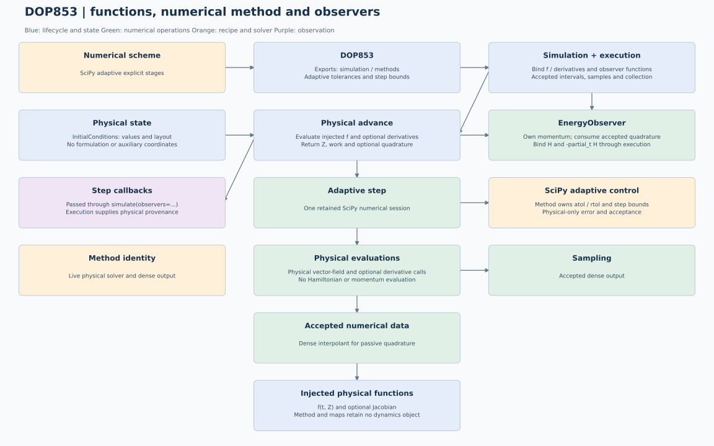

# DOP853: state formulations and execution

One retained SciPy explicit adaptive solver.

The canonical theoretical source is [theory.tex](../tex/theory.tex), with its
compiled [theory.pdf](../tex/theory.pdf). The physical-state contract below
supersedes earlier diagrams showing a duplicated clock or full time/momentum projection.

## Responsibilities

| Component | Owns |
|---|---|
| Dynamics | Physical vector field, Hamiltonian and required derivatives |
| Formulation | Optional doubled spatial copies |
| Method | Physical stages, projection equations and optional quadrature data |
| Solver | Nonlinear tolerances, iteration limits, derivatives and callbacks |
| EnergyObserver | Independent momentum and energy histories |
| Execution | Function injection, accepted intervals, sampling, observation and output collection |

## State contract

`DoubleFormulation(physical_size)` is the only state formulation. It prepares temporary copies through `lift`, `join_copies` and `split_copies`, preserving NumPy/JAX arrays and complete component blocks. Classical, HBVM and adaptive methods use the physical vector directly and instantiate no formulation. The doubled representation stores only a positive physical size; it contains no dynamics, solver or diagnostic state.

Every accepted snapshot is `IntegrationState(time, values)`: scalar time and a physical vector of shape `(d*N,)`. GC remains 2N and FC 4N with or without energy observation. Temporary doubled GC work has 4N entries; generic doubled FC work has 8N. These workspaces never become accepted states. This generic copy support does not extend GC numerical methods to FC.

Execution binds the physical functions and calls `new_run(f, initial_conditions, request, jacobian=..., jacobian_structure=...)`. The method receives no `DynamicalSystem` or problem. `advance(t, Z, h)` returns physical state, statistics, optional details and optional quadrature data. `EnergyObserver` owns its independent momentum and accumulates only accepted quadrature; shadow samples derive from the accepted observer state without committing it. Step callbacks are passed through `simulate(..., observers=(...,))`.

Enable passive energy with `simulate(..., observers=(EnergyObserver(),))`, importing `EnergyObserver` from `diagnostics.methods.energy`. Execution supplies the observer with H and `-partial_t H`. It evaluates saved physical H once and constructs the existing diagnostics. Energy labels and `(N,T)` auxiliary histories remain unchanged; `extended_time` is broadcast from scalar sample times. Old configured Python objects must be recreated; saved numerical archives retain their schemas.

## Energy and nonlinear work

Eight-point Gauss quadrature integrates the passive derivative along each accepted dense interpolant. Partial-interval quadrature supplies off-grid energy samples. This diagnostic quadrature has no separate adaptive tolerance or rigorous error bound; refine the physical step and check the balance.

Each accepted interval retains its initial and final momenta. Scalar or batched
queries at those endpoints reuse these values without new quadrature; interior
queries still use the eight-node partial-interval rule. Returned samples are
independent arrays. Energy tracking can still require extra DOP853 dense-output
field evaluations on intervals without requested samples; this diagnostic work
is excluded from physical solver counters.

The stored momentum is physical `kappa`, initialized at zero. Its derivative is
`-partial_t H`; splitting sums are normalized by one half. The diagnostic is
`H(t, z) + kappa - H(t0, z0)`. It measures a balance, not conservation of the
time-dependent physical Hamiltonian. Dynamics must implement
[`HamiltonianSystem`](../../../dynamics/protocols.md) when tracking is enabled.
It extends `DynamicalSystem` with `hamiltonian` and
`extended_momentum_derivative`, including an explicit zero derivative for an
autonomous Hamiltonian. With tracking disabled, only `DynamicalSystem` is
required for this energy choice; method-specific capabilities still apply.

Only spatial coordinates enter a Hairer constraint. The reduced multiplier has
2N components; the ABBA simultaneous spatial solve has 6N unknowns. Clock and
momentum never enlarge these roots or affect their stopping scale. Tracking also
leaves classical physical solves and adaptive acceptance decisions unchanged.
Passive energy quadrature and optional observer reconstruction are extra work
outside the physical solver counters; reported wall time still includes them.

## Lifecycle and output

Tolerance and optional first-step normalization use private helpers in
`methods._validation`; `first_step=None` still selects automatic startup.
The live-solver state, accepted-step bounds and derivative checks remain in the
adaptive execution path, where their values can change during integration.

By default, `simulate(problem, method)` delegates to `Execution.run`,
which prepares a fresh run via `new_run` and allocates one physical recorder.
The host worker advances and samples through the method's controller. Each
`advance` returns a physical state, work counters, accepted details and optional quadrature data.
The controller owns `IntegrationState(time, values)`. Requested samples are
extracted into physical coordinates and copied into `States`; step counters keep
their separate axis. The energy observer evaluates the saved physical Hamiltonian and combines it with its own momentum history.
Execution finalizes the same recorder once and closes the run on success or
failure. Configured methods remain reusable with isolated run resources.

Fixed methods use independent shortened maps for off-grid samples. Adaptive
methods retain one live SciPy solver whose state is always physical. Their
energy quadrature follows accepted dense output and cannot affect the error norm.
Radau Jacobians are physical-sized even when energy tracking is enabled.

Observers receive the physical map and independent snapshots. Their shapes do
not change with tracking. All energy histories have shape `(N, saved_times)`,
including `extended_time` even for a single particle. Diagnostic arrays
`extended_time`, `extended_momentum`,
`physical_hamiltonian`, `generalized_energy` and `generalized_energy_error` follow
`States.t`; nonlinear and runtime work arrays follow `step_times`.
`extended_momentum_normalization` is `physical_kappa` and `energy_error` is the
maximum absolute sampled balance error over all particles.

## Migration and verification

`state_extension="fully_extended"` no longer runs a time/momentum projection.
It raises explicit migration guidance. Use `observers=(EnergyObserver(),)` with spatial
projection. The historical full-state symplecticity study is retired because it
measured a different map; existing saved artifacts can still be read.

Tests in `tests/test_state_formulations.py` cover all 12 methods, both tracking
settings, particle batches, physical-only observers, adaptive control, per-particle
time alignment and energy normalization. Model tests retain order, projection,
Jacobian and nonlinear-solver checks. The pre-change physical trajectories are
also compared with the migrated implementations on short nonautonomous runs.

## Optional JAX execution

This model supports `simulate(..., options=ExecutionOptions(backend="jax", device="cpu"))`
(or a configured `device="gpu"`) with explicit float64. SciPy retains adaptive
acceptance, rejected trials, stages and dense interpolation, including Radau
Newton/LU when applicable. Batched physical field and energy evaluations run
on JAX with transfers at each evaluation. Diagnostics report
`execution_mode="hybrid_scipy_controller"`; the existing host callback and
optional Radau Jacobian contracts remain intact.

Import `ExecutionOptions` from `execution.options`. Omission preserves existing
SciPy/NumPy execution. See the [shared execution contract](../../../simulation/jax-execution.md)
for supported physical systems, solver details, timing scope and validation.

## Complete integration executor

`simulate(problem, method, execution=Execution())` delegates the complete
job to `Execution.run`. Import the executor with `from execution import Execution`.
The executor prepares the requested environment and a fresh numerical run, allocates one recorder, invokes the host or compiled worker and finalizes the result once. It owns run status on success and failure. It does not change thread counts, affinity
or global JAX settings. Subclasses can execute the same job elsewhere, while
`simulate` validates the completed `States`. Backend choices remain separate in
`options=ExecutionOptions(...)`. See the [executor contract](../../../simulation/execution.md).
Numerical stages, projection equations and step controllers retain their own
implementations inside this execution boundary. The base class is
`methods.base.IntegrationMethod`; time loops and sampling live inside `execution`,
with no separate integration package.

`Execution_Modal` now implements this boundary for remote NumPy/SciPy CPU
integrations. Results return to the local machine for validation and subsequent
persistence; see the [Modal executor guide](../../../simulation/modal-execution.md).

## Initial-state ownership

Dynamics declare `GCCoordinates()` for fixed `(x, y)` blocks or `FCCoordinates()` for fixed `(x, y, vx, vy)` blocks, from `dynamics.coordinates`. `PhysicalCoordinates` is a stateless base with common array operations; dimensions are fixed properties and no names or role-index fields are configured. `split()` returns an ordinary tuple. `JaxGCCoordinates` and `JaxFCCoordinates`, from `dynamics.jax_coordinates`, inherit their respective operations and only select `jnp` through `array_namespace`.

`InitialValueProblem` takes the dynamics declaration or requires an explicit layout. It never infers a model from dimension. `StateLayout.snapshot()` explicitly supplies an immutable NumPy convention; `describe_coordinates` validates that snapshot and its dimension. Compatibility compares the snapshot class and equality, even for equally sized arrays. Initial conditions and results own their arrays and conventions without retaining live dynamics or a potential. Custom conventions derive from `PhysicalCoordinates` and implement fixed operations instead of role tables; external adapters may supply these snapshots without inheritance. Packing and views preserve `(d*N,*samples)`, `(d,N,*samples)` and `(N,*samples)`. The respective JAX classes support tracing; incomplete blocks are rejected.

Built-in dynamics keep physical parameters immutable. A new problem is required for revised initial values. Saved numerical archives retain existing GC/FC schemas and can be interpreted without constructing dynamics or loading a field.

## Potential evaluation boundary

`Potential.evaluate` uses NumPy/SciPy; `JaxPotential` inherits its representation
and overrides only `evaluate` with JAX. Simulation preparation constructs
`JaxGuidingCenterDynamics` or `JaxFullCyclotronDynamics` from
`dynamics.jax_dynamics`; these subclasses only declare `JaxGCCoordinates` or `JaxFCCoordinates`
and inherit all physical methods. It supplies JAX potentials sharing the existing
splines, including the
gyroaveraged field, without refitting or mutating the source dynamics. Inherited
electric fields follow the potential class; `evaluate_grid` remains NumPy-only. See the
[shared potential contract](../../../dynamics/jax-potential-evaluation.md).

Dynamics declare `GCCoordinates()` for fixed `(x, y)` blocks or `FCCoordinates()` for fixed `(x, y, vx, vy)` blocks, from `dynamics.coordinates`. `PhysicalCoordinates` is a stateless base with common array operations; dimensions are fixed properties and no names or role-index fields are configured. `split()` returns an ordinary tuple. `JaxGCCoordinates` and `JaxFCCoordinates`, from `dynamics.jax_coordinates`, inherit their respective operations and only select `jnp` through `array_namespace`.

## Initial data and numerical components

The public problem constructor also accepts `states.InitialConditions`; existing
packed-array callers remain supported. See the [component interface](../../../simulation/initial-solvers-formulations.md)
for ownership, array shapes and unchanged request/result boundaries.

## State representation and step preparation

See the state contract above and the [representation operations](../../../simulation/initial-solvers-formulations.md#state-representations).

## Integration step

This method owns `max_step` (default 0.1), the bound used by its adaptive
controller. The request supplies only the interval and output times. See the
[step configuration contract](../../../simulation/execution.md#method-owned-integration-step).
