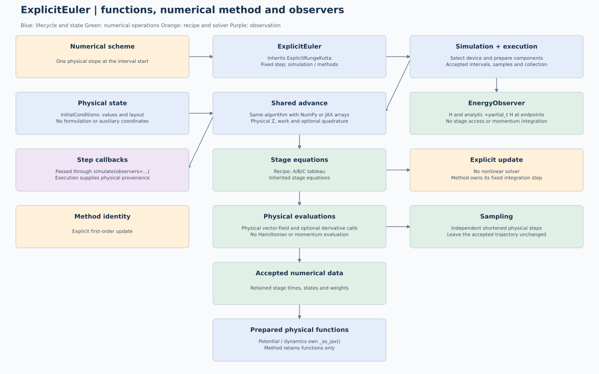

# ExplicitEuler: state formulations and execution

One forward Euler stage.

The canonical theoretical source is [theory.tex](../tex/theory.tex), with its
compiled [theory.pdf](../tex/theory.pdf). The physical-state contract below
supersedes earlier diagrams showing a duplicated clock or full time/momentum projection.

## Responsibilities

| Component | Owns |
|---|---|
| Dynamics | Physical vector field, Hamiltonian and required derivatives |
| Formulation | Optional doubled spatial copies |
| Method | Physical stages, projection equations and optional quadrature data |
| Solver | Nonlinear tolerances, iteration limits, derivatives and callbacks |
| EnergyObserver | Endpoint H and analytic positive partial_t H |
| Execution | Function injection, accepted intervals, sampling, observation and output collection |

## State contract

`DoubleFormulation(physical_size)` is the only state formulation. It prepares temporary copies through `lift`, `join_copies` and `split_copies`, preserving NumPy/JAX arrays and complete component blocks. Runge--Kutta and HBVM methods use the physical vector directly and instantiate no formulation. The doubled representation stores only a positive physical size; it contains no dynamics, solver or diagnostic state.

Every accepted snapshot is `IntegrationState(time, values)`: scalar time and a physical vector of shape `(d*N,)`. GC remains 2N and FC 4N with or without energy observation. Temporary doubled GC work has 4N entries; generic doubled FC work has 8N. These workspaces never become accepted states. This generic copy support does not extend GC numerical methods to FC.

`new_run(f, initial_conditions, *, jacobian=None)` creates a fresh run and calls `initialize(initial_conditions)`. Initial data and layout are temporary preparation inputs: the numerical base retains only functions, numerical metadata, run status and copy count. Execution owns the initial snapshot and passes it explicitly to controllers. Supplied Jacobians have independent particle shape `(N,d,d)`; finite-difference Jacobians remain dense. There is no `jacobian_structure`, `capture_quadrature` or method-level `progress` option.

`EnergyObserver()` records physical H and the positive analytic partial time derivative `hamiltonian_time_derivative` at accepted endpoints and requested physical samples. It does not consume internal stages or integrate momentum. Per-step diagnostics are `energy_start`, `energy_end`, `energy_change`, `energy_time_derivative_start` and `energy_time_derivative_end`, with shape `(steps,N)`. Saved histories `physical_hamiltonian` (alias `hamiltonian`), `energy_drift` and `hamiltonian_time_derivative` have shape `(N,T)`. Energy variation in a time-dependent Hamiltonian is not a numerical conservation error.

## Energy and nonlinear work

Forward Euler evaluates the passive derivative at the start of the accepted step.

## Lifecycle and output

Specialized historical generalized-energy studies explicitly use stage diagnostics under `diagnostics.methods.stage_energy` and `studies._generalized_energy`. They retain their signed quadrature, physical kappa normalization and archive labels. Generic execution has no momentum accumulator. `States.k` and `States.err` remain readers for historical diagnostics and return `None` when absent. Old numerical archives remain readable; recreate configured-object pickles after the API change.

## Migration and verification

`state_extension="fully_extended"` no longer runs a time/momentum projection.
It raises explicit migration guidance. Use `observers=(EnergyObserver(),)` with spatial
projection. The historical full-state symplecticity study is retired because it
measured a different map; existing saved artifacts can still be read.

Tests cover physical-only accepted states, isolated preparation, independent shadow samples, particle-block Jacobians, endpoint-only energy evaluation, analytic time differentiation, and CPU/JAX agreement. Model tests retain convergence, projection and nonlinear-work checks. Independent SciPy reference tests cover the retired adaptive API boundary.

## Optional JAX execution

This model supports `simulate(..., options=ExecutionOptions(backend="jax", device="cpu"))`
(or a configured `device="gpu"`) with explicit float64. The complete fixed time
loop, particle stages, applicable nonlinear/projection solves and passive energy
quadrature remain on that device until final NumPy `States` export. Its
coefficients, physical-state tolerance scaling and sampling conventions are
unchanged. JAX rejects unconverged solves explicitly. Diagnostics report
`execution_mode="device_resident"`. Python step observers and progress reporting
require the default CPU path.

Import `ExecutionOptions` from `execution.options`. Omission preserves existing
SciPy/NumPy execution. See the [shared execution contract](../../../simulation/jax-execution.md)
for supported physical systems, solver details, timing scope and validation.

## Complete integration executor

`simulate(problem, method, execution=Execution())` delegates the complete
job to `Execution.run`. Import the executor with `from execution import Execution`.
The executor prepares the requested environment and a fresh numerical run, allocates one recorder, invokes the host or compiled worker and finalizes the result once. It owns run status on success and failure. It does not change thread counts, affinity
or global JAX settings. Subclasses can execute the same job elsewhere, while
`simulate` validates the completed `States`. Backend choices remain separate in
`options=ExecutionOptions(...)`. See the [executor contract](../../../simulation/execution.md).
Numerical stages, projection equations and step controllers retain their own
implementations inside this execution boundary. The base class is
`methods.base.IntegrationMethod`; time loops and sampling live inside `execution`,
with no separate integration package.

`Execution_Modal` now implements this boundary for remote NumPy/SciPy CPU
integrations. Results return to the local machine for validation and subsequent
persistence; see the [Modal executor guide](../../../simulation/modal-execution.md).

## Initial-state ownership

Dynamics declare `GCCoordinates()` for fixed `(x, y)` blocks or `FCCoordinates()` for fixed `(x, y, vx, vy)` blocks, from `dynamics.coordinates`. `PhysicalCoordinates` is a stateless base with common array operations; dimensions are fixed properties and no names or role-index fields are configured. `split()` returns an ordinary tuple. `JaxGCCoordinates` and `JaxFCCoordinates`, from `dynamics.jax_coordinates`, inherit their respective operations and only select `jnp` through `array_namespace`.

`InitialValueProblem` takes the dynamics declaration or requires an explicit layout. It never infers a model from dimension. `StateLayout.snapshot()` explicitly supplies an immutable NumPy convention; `describe_coordinates` validates that snapshot and its dimension. Compatibility compares the snapshot class and equality, even for equally sized arrays. Initial conditions and results own their arrays and conventions without retaining live dynamics or a potential. Custom conventions derive from `PhysicalCoordinates` and implement fixed operations instead of role tables; external adapters may supply these snapshots without inheritance. Packing and views preserve `(d*N,*samples)`, `(d,N,*samples)` and `(N,*samples)`. The respective JAX classes support tracing; incomplete blocks are rejected.

Built-in dynamics keep physical parameters immutable. A new problem is required for revised initial values. States stores time rows `(T,d*N)`, with `states[i]` at `t[i]`; component accessors retain `(N,T)`. New solution archives use schema 2; the reader converts schema 1 columns explicitly. Archives can be interpreted without constructing dynamics or loading a field.

## Compiled fixed-step contract

Fixed-step methods use the same `advance` implementation with NumPy or JAX
arrays. They contain no JAX imports, backend declaration or alternate stages.
Execution owns compatibility checks and device selection; `execution._jax_step`
binds an isolated prepared method to `contracts.methods.compiled.CompiledStep`.
Potential, dynamics and solvers own their internal `_as_jax()` preparation.
`Execution.run` first builds a shared fixed-step and sampling plan for host
and JAX execution. It passes this plan to `execution._jax_fixed.prepare_integration`
to place inputs and compile the complete loop before `run_steps` executes the
returned `PreparedIntegration` and records its results.
See [JAX execution](../../../simulation/jax-execution.md).

## Potential evaluation boundary

`Potential.evaluate` uses NumPy/SciPy; `JaxPotential` inherits its representation
and overrides only `evaluate` with JAX. Simulation preparation constructs
`JaxGuidingCenterDynamics` or `JaxFullCyclotronDynamics` from
`dynamics.jax_dynamics`; these subclasses only declare `JaxGCCoordinates` or `JaxFCCoordinates`
and inherit all physical methods. It supplies JAX potentials sharing the existing
splines, including the
gyroaveraged field, without refitting or mutating the source dynamics. Inherited
electric fields follow the potential class; `evaluate_grid` remains NumPy-only. See the
[shared potential contract](../../../dynamics/jax-potential-evaluation.md).

Dynamics declare `GCCoordinates()` for fixed `(x, y)` blocks or `FCCoordinates()` for fixed `(x, y, vx, vy)` blocks, from `dynamics.coordinates`. `PhysicalCoordinates` is a stateless base with common array operations; dimensions are fixed properties and no names or role-index fields are configured. `split()` returns an ordinary tuple. `JaxGCCoordinates` and `JaxFCCoordinates`, from `dynamics.jax_coordinates`, inherit their respective operations and only select `jnp` through `array_namespace`.

## Initial data and numerical components

The public problem constructor also accepts `states.InitialConditions`; existing
packed-array callers remain supported. See the [component interface](../../../simulation/initial-solvers-formulations.md)
for ownership, array shapes and unchanged request/result boundaries.

## State representation and step preparation

See the state contract above and the [representation operations](../../../simulation/initial-solvers-formulations.md#state-representations).

## Integration step

This method owns its positive `step` (default 0.1 in runtime time units).
Complete steps retain that size; only the final accepted step is shortened.
`advance` receives the effective duration without modifying the configured value.
See the [shared scheduling contract](../../../simulation/execution.md#method-owned-integration-step)
for independent output sampling and the common CPU/JAX grid.

## Tableau-driven implementation

`ExplicitEuler` now inherits its numerical stage calculations from `ExplicitRungeKutta`
in `methods.runge_kutta`. The concrete recipe declares its immutable
`ButcherTableau(A, B, C)` and metadata. The shared `RungeKutta` base owns
physical step results and passive stage quadrature; solver and execution
responsibilities remain separate. See the [Runge–Kutta family contract](../../../simulation/runge-kutta.md)
for coefficient validation, generic construction and import migration.
