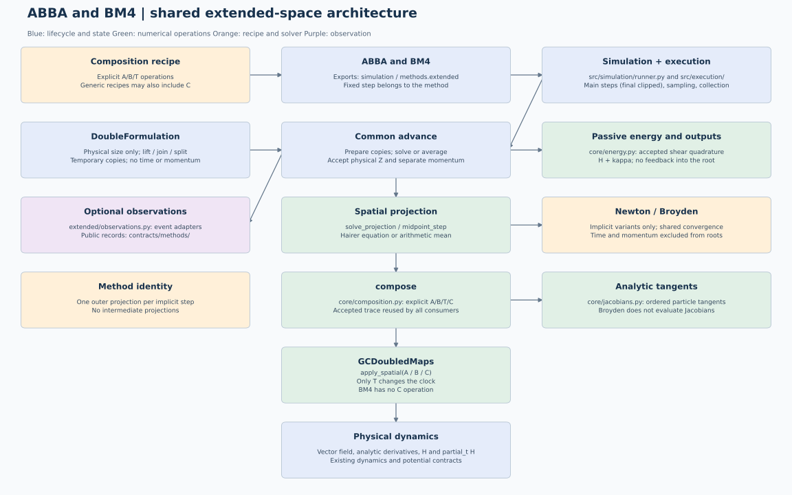

# Shared extended-space implementation

All presets now inherit PalindromicMethod and execute explicit A/B/T operations.
See [palindromic methods and time placement](palindromic-operations.md) for the common classes, generic recipes and independent C.

Both BM4 variants use uncoupled maps and have no coupling-frequency option.
See [uncoupled BM4 and independent C](uncoupled-bm4.md) for migration and historical-data handling.


The compact diagrams describe the current shared numerical execution and executor-owned lifecycle. Older detailed diagrams explicitly marked as historical retain their original ownership conventions.

ABBA and BM4 share the numerical implementation in
[`src/methods/extended/`](../../../../src/methods/extended/).
`extended` names the implementation family. Generic PalindromicImplicit and
PalindromicMidpoint methods accept explicit compositions for experiments.
The public method names and exports from `simulation`, `methods`, and
`methods.extended` remain available. ABBA6 now uses one outer projection,
matching ABBA4; its numerical map and observation structure change accordingly.
The canonical package is `methods.extended`; `formulations`, `execution`,
and `contracts` are sibling packages. Old `simulation.methods.*`,
`methods.abba.*`, and `methods.bm4.*` routes have been removed. Explicit public
exports refer to the canonical implementation, without module aliases or import
hooks. See the [import migration table](../../../simulation/integration-architecture.md#public-api-and-imports).



The canonical mathematical entry point is [theory.tex](../tex/theory.tex), with
its deliberate compiled [theory.pdf](../tex/theory.pdf). Diagram sources and
views can be regenerated with
`python scripts/render_extended_architecture.py`. That script writes matching
PlantUML/Graphviz graph specifications and fixed-layout SVG/PNG views from one
node-and-edge specification; an external Graphviz executable is not required.

## Execution and responsibilities

The ordinary implicit path is `advance -> solve_projection -> compose ->
A/B/T/C operations`. Initialization binds the recipe, spatial formulation,
solver options and Jacobian strategy once. The generic integration coordinator
continues to own step scheduling, output sampling, observer dispatch and history
collection. No per-order forwarding modules or separate ABBA composition drivers
remain. Diagnostic analysis consumes accepted events; independent residual
equations used only for verification live under `tests/_extended_reference/`.

Constructors validate method selectors. The configured algebraic solver
validates its controls without duplicating them on the method.
`IntegrationMethod.new_run` owns the immutable initial state and metadata
snapshots. BM4 reports the accepted tolerance directly from `SolveStats`, so
observation and integration use the same convergence threshold.

| Module or component | Responsibility |
|---|---|
| `extended/palindromic.py` | Common method inheritance, preparation, implicit/midpoint advancement and quadrature description |
| `extended/core/operations.py` | Immutable A/B/T/C operation coefficients |
| `extended/core/composition.py` | Complete validated operation palindromes and their chronological execution |
| `extended/core/projection.py` | Bind a composition, projection equations and algebraic solver |
| `methods/projection.py` | Reduced and simultaneous residuals, Jacobians, guesses and reconstruction |
| `solvers/nonlinear.py` | Shared Newton/Broyden convergence, iteration limits and counters |
| `extended/core/jacobians.py` | Exact ordered particle-block tangents and centered-difference fallback |
| `diagnostics/methods/energy.py` | Observer-owned passive momentum and energy diagnostics |
| `extended/core/records.py` | Numerical stage traces, projection results and per-solve statistics |
| `extended/core/midpoint.py` | Explicit arithmetic projection after the complete composition |
| `extended/abba.py`, `extended/bm4.py` | Preset recipes, public controls and observation adapters |
| `extended/configuration.py` | Shared selectors and configuration validation |
| `extended/observations.py` | On-demand ABBA pair and BM4 stage events from common numerical traces |
| `methods/extended/maps.py` | `GCDoubledMaps`: spatial direct/adjoint maps and optional coupling |
| `formulations/state.py` | `DoubleFormulation`: temporary complete spatial copies |

The family has one shallow shared engine directory:

```text
extended/
  __init__.py
  abba.py
  bm4.py
  configuration.py
  palindromic.py
  observations.py
  core/
    __init__.py
    composition.py
    operations.py
    projection.py
    midpoint.py
    jacobians.py
    records.py
```

ABBA4 and ABBA6 inherit the same preparation, advancement and placement
validation. Only their immutable recipes and formal orders differ. Coefficients
and recipes live together in `core/composition.py`. ABBA-specific observation
views stay outside the numerical core. Public exports are explicit; retired
`order*_implicit`, `order2_midpoint`, `bm4_midpoint`, `abba_steps`, and composition
adapter modules are not recreated as compatibility routes.

## Recipes and numerical identity

| Public method | Unprojected recipe | Diagonal projection per complete step |
|---|---|---|
| `ABBA2Implicit` | Adjoint/direct pair with weights `(1/2, 1/2)` | One reduced or simultaneous Hairer solve |
| `ABBA4Implicit` | Three continuous ABBA pairs: `(gamma, delta, gamma)` | One reduced or simultaneous solve around all six stages |
| `ABBA6Implicit` | Seven continuous signed ABBA pairs with Yoshida weights | One reduced or simultaneous solve around all fourteen stages |
| `BM4Implicit` | Twelve alternating stages with mirrored BM4 weights | One reduced Hairer solve |
| `ABBA2Midpoint` | One ABBA pair | One arithmetic mean |
| `BM4Midpoint` | Complete twelve-stage BM4 recipe | One arithmetic mean |

`ABBA4Implicit` is the fourth-order public configuration. ABBA uses uncoupled maps. Both BM4 variants also use uncoupled maps. HarmonicCoupling remains an independent C operation for future compositions.

The preset recipes expand each adjoint group into A,B,T and each direct group
into T,B,A, all with the original signed weight. The executor traverses those
explicit operations; only T changes the clock. This preserves endpoint times
and negative substeps without a parity-based clock rule. Reflected operations
and unit totals for A, B and T are checked separately. Higher orders still
require their additional order conditions.

Projection placement is part of method identity. ABBA6 intentionally changes
from seven projected pairs to one projection around fourteen stages. Historical
ABBA6 trajectories and timings must not be relabeled as results of the new map.
An arithmetic mean does not imply exact symplecticity or reversibility.

## State, projection and derivatives

For N planar particles the accepted state has 2N physical components. Time is scalar; an optional energy observer owns N separate physical momentum entries. The composition prepares two temporary spatial copies with 4N components, then returns a single physical state. Time and momentum never enter a nonlinear root.

With `E z = (z,z)`, `G = [I,-I]` and `N = G.T`, the reduced equation is
`r(mu) = G Psi_h(E z + N mu) + 2 mu = 0`. Its Jacobian is
`G D(Psi_h) N + 2 I`. Broyden starts from `4 I` and evaluates no analytic
Jacobians. The simultaneous ABBA equation retains both output copies and the
multiplier as 6N unknowns; its zero-step block Jacobian initializes Broyden.
Both formulations call the same general Newton/Broyden primitives.

Analytic Newton composes exact stage tangents from retained shear sources and
solves independent particle blocks (2 by 2 reduced, 6 by 6 simultaneous). It
replays no vector-field stages to obtain those sources. BM4's existing optional
centered-difference strategy differentiates the complete doubled map instead.
All roots retain the physical scale `atol + rtol * max(1, ||z||_inf)`.

## Energy, sampling and observation

Implicit ABBA steps, like BM4 steps, place one `ProjectedMapResult` directly in
`contracts.methods.step.StepResult.details`. The common step contract owns the physical result and optional quadrature data; the projection record owns the physical state, solver statistics and
accepted composition trace. The redundant private `core.records.StepResult`
and its projection tuple have been removed. Observers and reverse-step diagnostics
consume the projection record directly. Published diagnostic names and shapes,
including the one-column ABBA4/ABBA6 solve histories, remain unchanged.

Only the converged residual's trace is used for accepted energy quadrature.
`Delta kappa = (1/2) sum_j s_j (-partial_t H)(t_j, z_j)` sums individual
signed **shears**, two per direct/adjoint stage. The factor one half converts the
doubled Hamiltonian's summed momentum to physical kappa. Coupling does not alter
that passive momentum. The diagnostic is `H(t,z) + kappa - H(t0,z0)`;
it measures energy balance, not conservation of the time-dependent physical H.

Tracking neither enlarges a nonlinear root nor adds spatial field evaluations,
and all public observers receive independent physical snapshots. Numerical
traces do not allocate public events when no observer is requested. Shadow steps
for off-grid output remain independent and do not emit main-step observations.
Per-particle energy histories align with saved times; nonlinear work arrays align
with accepted main steps. ABBA6 reports `nonlinear_solves_per_step=1`, `implicit_substeps_per_step=1`,
`unprojected_abba_maps_per_step=7`, `composition_stage_count=14`, and
`base_composition="unprojected_abba6_yoshida"`. Its `substep_nonlinear_*` and
`substep_projection_multiplier_norms` histories have shape `(steps, 1)`.
`ABBA4ImplicitIntegrationStep` and `ABBA6ImplicitIntegrationStep` share the
`ABBAImplicitCompositionIntegrationStep` contract: one outer multiplier and
respectively three or seven `UnprojectedABBAIntegrationStep` records. Reduced
and simultaneous roots both expose the same physical observation domain.
The ABBA6 exact-tangent function and reversibility observer differentiate this
single outer root; they do not multiply seven projected physical Jacobians.

## Parallel study potential snapshots

The ABBA4 configuration comparison and parallel BM4 recurrence study share
`studies._potential_snapshot._H5PotentialSnapshot`. It carries the processed
grid, mean, complex modes, frequencies, HDF5 provenance, and interpolation
order to spawned workers. Each worker reconstructs its own runtime potential
without reopening the source file. Scheduling, trajectory collection, and
scientific summaries remain local to each study; this helper does not define
a common experiment runner.

## Study presentation

ABBA and BM4 studies return numerical data and summaries; figures and animations
are built by functions in `visualization`. GC symplecticity views, ABBA defect
floors and midpoint convergence plots live in `visualization.gc_symplecticity`.
Comparison views live in `visualization.abba_comparison` and
`visualization.area_comparison`; trajectory symplecticity views live in
`visualization.trajectory_symplecticity`, and generalized-energy plots live in
`visualization.energy`. Each function takes the completed study result first.
The former result plotting and animation methods are removed. See the
[migration table](../../../simulation/api-migration.md#study-result-visualization)
for exact imports and replacements. Numerical maps, observers and persisted
results are unchanged by this separation.

## Verification

`tests/test_extended_family.py` checks common solver binding, public class
identity, coefficient validation, projection placement, endpoint shear
agreement, signed nonautonomous reversibility, analytic tangents, and passive
tracking/observation without extra spatial work. Existing method tests retain
convergence order, projection equations, observer compatibility, energy balance,
vectorized particles and sampling contracts. `tests/test_abba6.py` additionally
checks sixth-order convergence for nonlinear nonautonomous dynamics with both
root formulations and Newton/Broyden, signed reversal, the outer constraint,
analytic versus finite-difference tangents and symplecticity. The ABBA6 change
is intentional; the other methods preserve their numerical maps.

## Complete integration executor

`simulate(problem, method, request, execution=Execution())` delegates the complete
job to `Execution.run`. Import the executor with `from execution import Execution`.
The executor prepares the requested environment and a fresh numerical run, allocates one recorder, invokes the host or compiled worker and finalizes the result once. It owns run status on success and failure. It does not change thread counts, affinity
or global JAX settings. Subclasses can execute the same job elsewhere, while
`simulate` validates the completed `States`. Backend choices remain separate in
`options=ExecutionOptions(...)`. See the [executor contract](../../../simulation/execution.md).
Numerical stages, projection equations and step controllers retain their own
implementations inside this execution boundary. The base class is
`methods.base.IntegrationMethod`; time loops and sampling live inside `execution`,
with no separate integration package.

`Execution_Modal` now implements this boundary for remote NumPy/SciPy CPU
integrations. Results return to the local machine for validation and subsequent
persistence; see the [Modal executor guide](../../../simulation/modal-execution.md).

## Initial-state ownership

Dynamics declare `GCCoordinates()` for fixed `(x, y)` blocks or `FCCoordinates()` for fixed `(x, y, vx, vy)` blocks, from `dynamics.coordinates`. `PhysicalCoordinates` is a stateless base with common array operations; dimensions are fixed properties and no names or role-index fields are configured. `split()` returns an ordinary tuple. `JaxGCCoordinates` and `JaxFCCoordinates`, from `dynamics.jax_coordinates`, inherit their respective operations and only select `jnp` through `array_namespace`.

`InitialValueProblem` takes the dynamics declaration or requires an explicit layout. It never infers a model from dimension. `StateLayout.snapshot()` explicitly supplies an immutable NumPy convention; `describe_coordinates` validates that snapshot and its dimension. Compatibility compares the snapshot class and equality, even for equally sized arrays. Initial conditions and results own their arrays and conventions without retaining live dynamics or a potential. Custom conventions derive from `PhysicalCoordinates` and implement fixed operations instead of role tables; external adapters may supply these snapshots without inheritance. Packing and views preserve `(d*N,*samples)`, `(d,N,*samples)` and `(N,*samples)`. The respective JAX classes support tracing; incomplete blocks are rejected.

Built-in dynamics keep physical parameters immutable. A new problem is required for revised initial values. Saved numerical archives retain existing GC/FC schemas and can be interpreted without constructing dynamics or loading a field.

## Explicit Newton iteration observation

Configure callbacks on `NewtonSolver(iteration_observer=callback)` and pass it as `solver=` to the method. The solver also owns absolute and relative tolerances, correction limits, Jacobian selection, finite-difference scale and backtracking. Method constructors retain only numerical equations, coefficients and integration policy.

The callback receives independent read-only `contracts.solvers.nonlinear.NewtonIteration` records for already evaluated iterates: initial guess, accepted root and a final failed iterate when applicable. Unknowns, residuals and any projection multiplier are copied; observation adds no field, residual or Jacobian evaluations. The callback belongs to the configured solver, without global instrumentation.

Direct advances and off-grid output solves emit iterates. Diagnostic `map_state` replay explicitly disables them. Use aligned complete-step outputs when collecting one history per main step. Broyden, compiled JAX and remote Modal execution reject unsupported Python iteration callbacks. Exceptions propagate from the run. Portable source bundles must include the matching solver and contracts; historical immutable bundles remain unchanged.

Gauss, SDIRK, and analytic spatial projection share
`solvers.linear._solve_particle_systems`: matrices have shape `(N,d,d)` and
right-hand-side vectors have shape `(N,d)`. The helper inserts one explicit
right-hand-side axis for `numpy.linalg.solve`, preserving behavior with NumPy
1.x and 2.x. The projection equations and particle ordering are unchanged.

## Compiled fixed-step contract

Fixed-step methods use the same `advance` implementation with NumPy or JAX
arrays. They contain no JAX imports, backend declaration or alternate stages.
Execution owns compatibility checks and device selection; `execution._jax_step`
binds an isolated prepared method to `contracts.methods.compiled.CompiledStep`.
Potential, dynamics and solvers own their internal `_as_jax()` preparation.
The shared `execution/_jax_fixed.py` loop handles scheduling and sampling.
See [JAX execution](../../../simulation/jax-execution.md).

## Potential evaluation boundary

`Potential.evaluate` uses NumPy/SciPy; `JaxPotential` inherits its representation
and overrides only `evaluate` with JAX. Simulation preparation constructs
`JaxGuidingCenterDynamics` or `JaxFullCyclotronDynamics` from
`dynamics.jax_dynamics`; these subclasses only declare `JaxGCCoordinates` or `JaxFCCoordinates`
and inherit all physical methods. It supplies JAX potentials sharing the existing
splines, including the
gyroaveraged field, without refitting or mutating the source dynamics. Inherited
electric fields follow the potential class; `evaluate_grid` remains NumPy-only. See the
[shared potential contract](../../../dynamics/jax-potential-evaluation.md).

Dynamics declare `GCCoordinates()` for fixed `(x, y)` blocks or `FCCoordinates()` for fixed `(x, y, vx, vy)` blocks, from `dynamics.coordinates`. `PhysicalCoordinates` is a stateless base with common array operations; dimensions are fixed properties and no names or role-index fields are configured. `split()` returns an ordinary tuple. `JaxGCCoordinates` and `JaxFCCoordinates`, from `dynamics.jax_coordinates`, inherit their respective operations and only select `jnp` through `array_namespace`.

## Initial data and numerical components

The public problem constructor also accepts `states.InitialConditions`; existing
packed-array callers remain supported. See the [component interface](../../../simulation/initial-solvers-formulations.md)
for ownership, array shapes and unchanged request/result boundaries.

ABBA separates `ReducedProjection` and `SimultaneousProjection` in
`methods.projection`; the method provides the composition and its derivative.
The equation object owns the 2N/6N residual and reconstruction. `solver=` accepts
`NewtonSolver(...)` or `BroydenSolver(...)`; nonlinear tolerances and derivative
options belong exclusively to those objects. CPU and JAX use the same equation classes.

## State representation and step preparation

`DoubleFormulation(physical_size)` is the only state formulation. It prepares temporary copies through `lift`, `join_copies` and `split_copies`, preserving NumPy/JAX arrays and complete component blocks. Classical, HBVM and adaptive methods use the physical vector directly and instantiate no formulation. The doubled representation stores only a positive physical size; it contains no dynamics, solver or diagnostic state.

Every accepted snapshot is `IntegrationState(time, values)`: scalar time and a physical vector of shape `(d*N,)`. GC remains 2N and FC 4N with or without energy observation. Temporary doubled GC work has 4N entries; generic doubled FC work has 8N. These workspaces never become accepted states. This generic copy support does not extend GC numerical methods to FC.

Execution binds the physical functions and calls `new_run(f, initial_conditions, request, jacobian=..., jacobian_structure=...)`. The method receives no `DynamicalSystem` or problem. `advance(t, Z, h)` returns physical state, statistics, optional details and optional quadrature data. `EnergyObserver` owns its independent momentum and accumulates only accepted quadrature; shadow samples derive from the accepted observer state without committing it. Step callbacks are passed through `simulate(..., observers=(...,))`.

Enable passive energy with `simulate(..., observers=(EnergyObserver(),))`, importing `EnergyObserver` from `diagnostics.methods.energy`. Execution supplies the observer with H and `-partial_t H`. It evaluates saved physical H once and constructs the existing diagnostics. Energy labels and `(N,T)` auxiliary histories remain unchanged; `extended_time` is broadcast from scalar sample times. Old configured Python objects must be recreated; saved numerical archives retain their schemas.

## Integration step

This method owns its positive `step` (default 0.1 in runtime time units).
Complete steps retain that size; only the final accepted step is shortened.
`advance` receives the effective duration without modifying the configured value.
See the [shared scheduling contract](../../../simulation/execution.md#method-owned-integration-step)
for independent output sampling and the common CPU/JAX grid.
