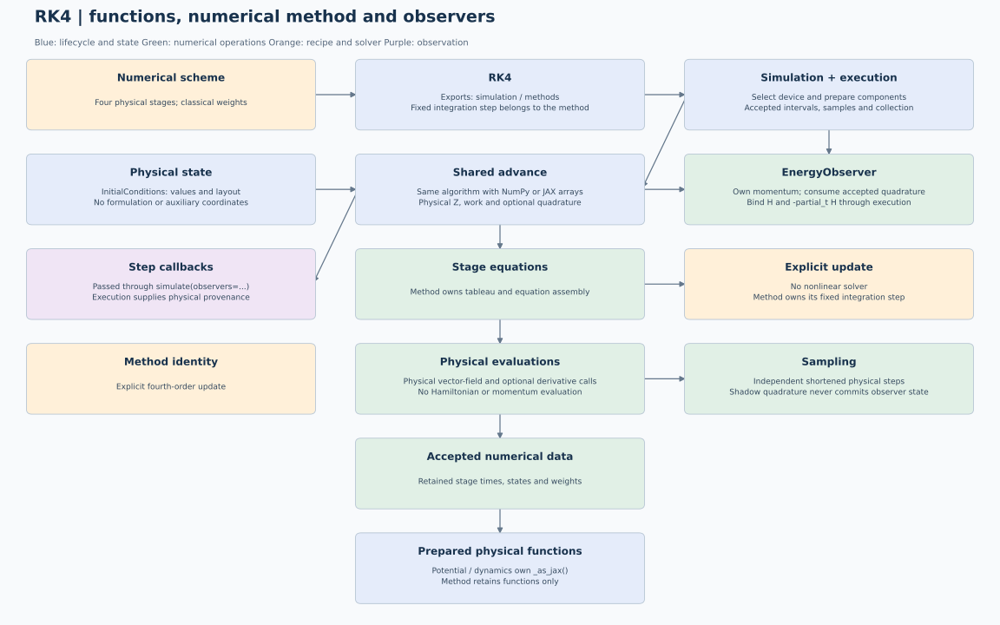

# RK4: state formulations and execution

Four classical Runge--Kutta stages.

The canonical theoretical source is [theory.tex](../tex/theory.tex), with its
compiled [theory.pdf](../tex/theory.pdf). The physical-state contract below
supersedes earlier diagrams showing a duplicated clock or full time/momentum projection.



## Responsibilities

| Component | Owns |
|---|---|
| Dynamics | Physical vector field, Hamiltonian and required derivatives |
| Formulation | Optional doubled spatial copies |
| Method | Physical stages, projection equations and optional quadrature data |
| Solver | Nonlinear tolerances, iteration limits, derivatives and callbacks |
| EnergyObserver | Independent momentum and energy histories |
| Execution | Function injection, accepted intervals, sampling, observation and output collection |

## State contract

`DoubleFormulation(physical_size)` is the only state formulation. It prepares temporary copies through `lift`, `join_copies` and `split_copies`, preserving NumPy/JAX arrays and complete component blocks. Classical, HBVM and adaptive methods use the physical vector directly and instantiate no formulation. The doubled representation stores only a positive physical size; it contains no dynamics, solver or diagnostic state.

Every accepted snapshot is `IntegrationState(time, values)`: scalar time and a physical vector of shape `(d*N,)`. GC remains 2N and FC 4N with or without energy observation. Temporary doubled GC work has 4N entries; generic doubled FC work has 8N. These workspaces never become accepted states. This generic copy support does not extend GC numerical methods to FC.

Execution binds the physical functions and calls `new_run(f, initial_conditions, request, jacobian=..., jacobian_structure=...)`. The method receives no `DynamicalSystem` or problem. `advance(t, Z, h)` returns physical state, statistics, optional details and optional quadrature data. `EnergyObserver` owns its independent momentum and accumulates only accepted quadrature; shadow samples derive from the accepted observer state without committing it. Step callbacks are passed through `simulate(..., observers=(...,))`.

Enable passive energy with `simulate(..., observers=(EnergyObserver(),))`, importing `EnergyObserver` from `diagnostics.methods.energy`. Execution supplies the observer with H and `-partial_t H`. It evaluates saved physical H once and constructs the existing diagnostics. Energy labels and `(N,T)` auxiliary histories remain unchanged; `extended_time` is broadcast from scalar sample times. Old configured Python objects must be recreated; saved numerical archives remain readable through versioned history conversion.

## Energy and nonlinear work

The passive momentum uses the same four stage states and weights as the physical RK4 update.

The stored momentum is physical `kappa`, initialized at zero. Its derivative is
`-partial_t H`; splitting sums are normalized by one half. The diagnostic is
`H(t, z) + kappa - H(t0, z0)`. It measures a balance, not conservation of the
time-dependent physical Hamiltonian. Dynamics must implement
[`HamiltonianSystem`](../../../dynamics/protocols.md) when tracking is enabled.
It extends `DynamicalSystem` with `hamiltonian` and
`extended_momentum_derivative`, including an explicit zero derivative for an
autonomous Hamiltonian. With tracking disabled, only `DynamicalSystem` is
required for this energy choice; method-specific capabilities still apply.

Only spatial coordinates enter a Hairer constraint. The reduced multiplier has
2N components; the ABBA simultaneous spatial solve has 6N unknowns. Clock and
momentum never enlarge these roots or affect their stopping scale. Tracking also
leaves classical physical solves and adaptive acceptance decisions unchanged.
Passive energy quadrature and optional observer reconstruction are extra work
outside the physical solver counters; reported wall time still includes them.

## Lifecycle and output

By default, `simulate(problem, method)` delegates to `Execution.run`,
which prepares a fresh run via `new_run` and allocates one physical recorder.
The host worker advances and samples through the method's controller. Each
`advance` returns a physical state, work counters, accepted details and optional quadrature data.
The controller owns `IntegrationState(time, values)`. Requested samples are
extracted into physical coordinates and copied into `States`; step counters keep
their separate axis. The energy observer evaluates the saved physical Hamiltonian and combines it with its own momentum history.
Execution finalizes the same recorder once and closes the run on success or
failure. Configured methods remain reusable with isolated run resources.

Fixed methods use independent shortened maps for off-grid samples. Adaptive
methods retain one live SciPy solver whose state is always physical. Their
energy quadrature follows accepted dense output and cannot affect the error norm.
Radau Jacobians are physical-sized even when energy tracking is enabled.

Observers receive the physical map and independent snapshots. Their shapes do
not change with tracking. All energy histories have shape `(N, saved_times)`,
including `extended_time` even for a single particle. Diagnostic arrays
`extended_time`, `extended_momentum`,
`physical_hamiltonian`, `generalized_energy` and `generalized_energy_error` follow
`States.t`; nonlinear and runtime work arrays follow `step_times`.
`extended_momentum_normalization` is `physical_kappa` and `energy_error` is the
maximum absolute sampled balance error over all particles.

### Study presentation

RK4 study results hold numerical data and summaries. Import
`plot_gc_symplecticity_diagnostics`, `plot_rk4_convergence`, or
`animate_gc_symplecticity` from `visualization.gc_symplecticity` and pass the
completed result as the first argument. The corresponding result methods
`plot_diagnostics()`, `plot_convergence()`, and `animate()` have been removed.
Generalized-energy result plots similarly use
`visualization.energy.plot_generalized_energy_comparison(result)`. These
presentation functions preserve their former options and outputs; integration
and persistence are unchanged. See the
[migration table](../../../simulation/api-migration.md#study-result-visualization)
for the other study result views.

## JAX execution

```python
import jax
from diagnostics.methods.energy import EnergyObserver
from execution.options import ExecutionOptions
from methods.classical.rk4 import RK4
from simulation.runner import simulate

jax.config.update("jax_enable_x64", True)
solution = simulate(
    problem.with_request(request), RK4(),
    observers=(EnergyObserver(),),
    options=ExecutionOptions(backend="jax", device="cpu"),
)
# Use device="gpu", device_index=0 on a configured JAX GPU installation.
```

`ExecutionOptions()` or omission preserves the existing SciPy/NumPy CPU path. The JAX
extra is optional; CPU integration never imports it. JAX requires explicit
float64 configuration and available hardware, with no automatic fallback.
`ExecutionOptions` describes resources separately from physical data and RK4 controls.

Both routes use the canonical RK4 stages in
`methods/classical/_rk4_core.py`; the energy observer owns passive quadrature. The default controller retains its Python
lifecycle. For JAX, `Execution.run` prepares a fresh run and selects the common
fixed-step compiled driver in `execution/_jax_fixed.py`. Execution injects functions implementing the same
GC/FC physical equations in `dynamics/_equations.py` into both paths.
Execution preparation binds JAX field evaluation through `JaxPotential`, reusing
the existing SciPy spline coefficients without refitting.

Preparation explicitly compiles the complete time loop using `jax.lax.scan`
before `run_steps` executes it. Particle
operations are batched within each stage; stages and successive time steps
remain sequential. The accepted state and requested output buffer stay on one
device. Storage scales with requested samples, rather than all internal steps.
Off-grid samples use independent shortened RK4 maps from the accepted interval
start, with the same endpoint tolerance and priority as the CPU controller.
They never change the subsequent main trajectory. Every accepted and sampled
state contributes to a finite-value check, including unsaved main states.

Tracking uses the same four physical stage states for `-partial_t H` on the
device. Physical Hamiltonian histories are also evaluated there, then the
energy observer constructs energy diagnostics after one synchronized
transfer of the completed output. The result remains an immutable NumPy
`States` with identical layouts, sampling and diagnostic definitions.
Execution metadata reports backend, device, index and the JAX device kind.

The compiled route supports the built-in `GuidingCenterDynamics` and
`FullCyclotronDynamics`, including gyroaveraging and time-dependent fields.
It rejects custom dynamics, method subclasses, Python step callbacks in `observers` and
`progress=True` explicitly. Use the CPU path for Python observation/progress.
All other built-in fixed methods share this driver; DOP853/Radau use an explicit
hybrid path. See the [execution guide](../../../simulation/jax-execution.md).
This route uses one device, not multi-GPU sharding.

### Reproducible test notebooks

The local, Git-ignored directory `notebooks/developements/rk4_execution/`
contains `calculation.ipynb` and `visualisation.ipynb`. The default short test
uses 256 particles in a seeded synthetic periodic field, 200 steps, passive
energy tracking and three alternating timing repetitions. It deliberately
tests backend equivalence rather than the long-time method-comparison protocol.
The calculation delegates composition to `studies.rk4_execution`, asserts
trajectory and energy agreement and saves all trajectories, parameters, raw
timings, software versions and field samples through canonical States archives.
The visualisation delegates plots to `visualization.rk4_execution` and only
loads saved data. Both derive the same destination with `solution_destination`:
bucket storage is the default; `storage="local"` is an explicit alternative.

First-call timing includes device preparation and compilation when required.
Warmed timings include complete integration, transfers, energy diagnostics and
States creation; input field preparation is excluded. Changing particle count
or output shapes can trigger recompilation. Reusing a kernel can make another
first call warm. CPU timing results do not establish GPU performance.

`tests/test_jax_rk4.py` compares GC/FC trajectories and energy diagnostics,
irregular and sparse samples, independent particles, a known time-dependent
shear with fourth-order convergence, optional imports, and explicit capability
failures. GPU equivalence runs only when a GPU is available. The study test
round-trips canonical archives and keeps visualisation independent of integration.

## Migration and verification

RK4 returns the canonical in-memory `States` through `simulation.runner`.
Optional persistence is a subsequent operation:
`diagnostics.io.persistence.save_solution(solution, destination, metadata=..., potential=...)`.
Omitting `destination` and supplying `experiment_path` and `run_id` selects the
configured data bucket by default. Local storage requires an explicit local
destination, optionally built by `solution_destination(..., storage="local")`.
The destination selects a local result directory or a configured rclone bucket
prefix. `load_solution` restores the GC/FC layout, diagnostics and optional
sampled potential independently of RK4, allowing a separate visualisation notebook
to consume a completed calculation. The small `studies.persistence_demo` example
stores the base field, `rho`, full RK4 request and synthetic-field recipe.
See the [persistence contract](../../../../src/diagnostics/README.md) for the
manifest, supported formats and transfer-failure behavior.

`state_extension="fully_extended"` no longer runs a time/momentum projection.
It raises explicit migration guidance. Use `observers=(EnergyObserver(),)` with spatial
projection. The historical full-state symplecticity study is retired because it
measured a different map; existing saved artifacts can still be read.

Tests in `tests/test_state_formulations.py` cover all 12 methods, both tracking
settings, particle batches, physical-only observers, adaptive control, per-particle
time alignment and energy normalization. Model tests retain order, projection,
Jacobian and nonlinear-solver checks. The pre-change physical trajectories are
also compared with the migrated implementations on short nonautonomous runs.

## Complete integration executor

`simulate(problem, method, execution=Execution())` delegates the complete
job to `Execution.run`. Import the executor with `from execution import Execution`.
The executor prepares the requested environment and a fresh numerical run, allocates one recorder, invokes the host or compiled worker and finalizes the result once. It owns run status on success and failure. It does not change thread counts, affinity
or global JAX settings. Subclasses can execute the same job elsewhere, while
`simulate` validates the completed `States`. Backend choices remain separate in
`options=ExecutionOptions(...)`. See the [executor contract](../../../simulation/execution.md).
Numerical stages, projection equations and step controllers retain their own
implementations inside this execution boundary. The base class is
`methods.base.IntegrationMethod`; time loops and sampling live inside `execution`,
with no separate integration package.

`Execution_Modal` implements this boundary for remote NumPy/SciPy or JAX CPU
integrations. Results return to the local machine for validation and subsequent
persistence; see the [Modal executor guide](../../../simulation/modal-execution.md).

The matched Poincare star study selects this canonical implementation with
`studies.poincare_rho_sweep.RhoStarConfig(method="RK4", ...)`. It uses the same
physical field, geometry, radial Hamiltonian normalization and complete-step grid
as the implicit-method studies. Set `coupling_frequency=0`, since RK4 has no
doubled copies; Newton controls do not participate in its explicit stages.
JAX CPU float64 execution retains the initial state and integer-cycle returns,
optionally adding folded coordinates after integration. Its scalar metadata must
not report nonlinear solves or projection. These cycle-only archives exclude
per-step arrays and do not certify independent trajectory accuracy.
The radial Poincare study also supports explicit additional initial positions via
`studies.poincare_gap_probes.GapProbeSeeds` and `prepare_gap_probes`. These use
the same canonical method, physical dynamics, complete-step grid and JAX/Modal
execution as the original star. Probe archives retain their own seed geometry
and IDs and are saved separately; viewers append their coordinates after checking
the field fingerprint, scientific settings and aligned cycle times. The eight
gap probes have IDs 41–48, with two positions per gap selected at rho=0.30 and
reused for all eleven rho values. See the
[batch and persistence protocol](../../../simulation/modal-execution.md#additional-particles-inside-saved-poincare-gaps).

## Initial-state ownership

Dynamics declare `GCCoordinates()` for fixed `(x, y)` blocks or `FCCoordinates()` for fixed `(x, y, vx, vy)` blocks, from `dynamics.coordinates`. `PhysicalCoordinates` is a stateless base with common array operations; dimensions are fixed properties and no names or role-index fields are configured. `split()` returns an ordinary tuple. `JaxGCCoordinates` and `JaxFCCoordinates`, from `dynamics.jax_coordinates`, inherit their respective operations and only select `jnp` through `array_namespace`.

`InitialValueProblem` takes the dynamics declaration or requires an explicit layout. It never infers a model from dimension. `StateLayout.snapshot()` explicitly supplies an immutable NumPy convention; `describe_coordinates` validates that snapshot and its dimension. Compatibility compares the snapshot class and equality, even for equally sized arrays. Initial conditions and results own their arrays and conventions without retaining live dynamics or a potential. Custom conventions derive from `PhysicalCoordinates` and implement fixed operations instead of role tables; external adapters may supply these snapshots without inheritance. Packing and views preserve `(d*N,*samples)`, `(d,N,*samples)` and `(N,*samples)`. The respective JAX classes support tracing; incomplete blocks are rejected.

Built-in dynamics keep physical parameters immutable. A new problem is required for revised initial values. States stores time rows `(T,d*N)`, with `states[i]` at `t[i]`; component accessors retain `(N,T)`. New solution archives use schema 2; the reader converts schema 1 columns explicitly. Archives can be interpreted without constructing dynamics or loading a field.

## Compiled fixed-step contract

Fixed-step methods use the same `advance` implementation with NumPy or JAX
arrays. They contain no JAX imports, backend declaration or alternate stages.
Execution owns compatibility checks and device selection; `execution._jax_step`
binds an isolated prepared method to `contracts.methods.compiled.CompiledStep`.
Potential, dynamics and solvers own their internal `_as_jax()` preparation.
`Execution.run` first builds a shared fixed-step and sampling plan for host
and JAX execution. It passes this plan to `execution._jax_fixed.prepare_integration`
to place inputs and compile the complete loop before `run_steps` executes the
returned `PreparedIntegration` and records its results.
See [JAX execution](../../../simulation/jax-execution.md).

## Potential evaluation boundary

`Potential.evaluate` uses NumPy/SciPy; `JaxPotential` inherits its representation
and overrides only `evaluate` with JAX. Simulation preparation constructs
`JaxGuidingCenterDynamics` or `JaxFullCyclotronDynamics` from
`dynamics.jax_dynamics`; these subclasses only declare `JaxGCCoordinates` or `JaxFCCoordinates`
and inherit all physical methods. It supplies JAX potentials sharing the existing
splines, including the
gyroaveraged field, without refitting or mutating the source dynamics. Inherited
electric fields follow the potential class; `evaluate_grid` remains NumPy-only. See the
[shared potential contract](../../../dynamics/jax-potential-evaluation.md).

Dynamics declare `GCCoordinates()` for fixed `(x, y)` blocks or `FCCoordinates()` for fixed `(x, y, vx, vy)` blocks, from `dynamics.coordinates`. `PhysicalCoordinates` is a stateless base with common array operations; dimensions are fixed properties and no names or role-index fields are configured. `split()` returns an ordinary tuple. `JaxGCCoordinates` and `JaxFCCoordinates`, from `dynamics.jax_coordinates`, inherit their respective operations and only select `jnp` through `array_namespace`.

## Initial data and numerical components

The public problem constructor also accepts `states.InitialConditions`; existing
packed-array callers remain supported. See the [component interface](../../../simulation/initial-solvers-formulations.md)
for ownership, array shapes and unchanged request/result boundaries.

## State representation and step preparation

See the state contract above and the [representation operations](../../../simulation/initial-solvers-formulations.md#state-representations).

## Integration step

This method owns its positive `step` (default 0.1 in runtime time units).
Complete steps retain that size; only the final accepted step is shortened.
`advance` receives the effective duration without modifying the configured value.
See the [shared scheduling contract](../../../simulation/execution.md#method-owned-integration-step)
for independent output sampling and the common CPU/JAX grid.
