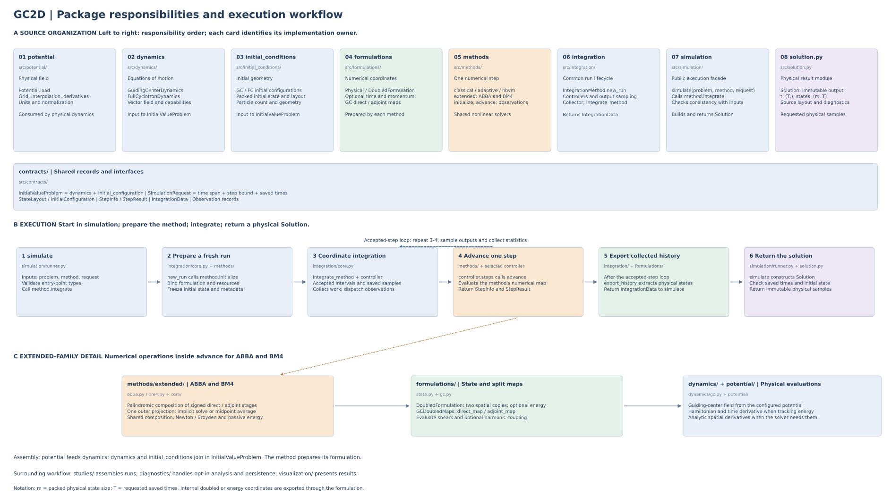

# Integration and the four state formulations

All 13 public methods use executor-owned preparation through `IntegrationMethod.new_run`.
Execution selects the host or device driver. Dynamics defines physics; formulation
defines coordinates; the method defines numerical operations; execution controls
accepted intervals and collects output.

`request.py` owns temporal configuration; `contracts/` owns problem and step contracts. `formulations.layout` owns physical layouts, while reusable formulations define internal coordinates and extraction independently of method choice. `methods/` implements numerical steps. `execution/` owns preparation, accepted `IntegrationState` snapshots, sampling and host/device loops; `methods.base` owns numerical preparation. `states/` owns the physical recording container and completed result. `simulation/runner.py` validates that result against the inputs and returns the same object. Internal consumers import directly from each defining module.

Validation follows the same ownership: `InitialValueProblem` checks the dynamics
protocol and compatible initial layout; state formulations check the Hamiltonian
capability needed for energy tracking; method constructors check their numerical
options. Methods reuse these validated inputs instead of repeating the same
capability checks. `IntegrationMethod.new_run` owns immutable run snapshots.

Long validation blocks are organized as private preparation functions within
their owning modules. `SimulationRequest` separates interval validation from
output-schedule normalization, and reuses the interval rule in `uniform`.
`States` prepares the physical history and immutable diagnostics separately;
the runner retains responsibility for agreement with the requested initial state
and saved times. Run preparation similarly separates initial-state ownership
and metadata freezing from the method lifecycle.

Scalar option rules shared by numerical families live in `methods._validation`.
Callers retain their existing conversion policies, including whether Boolean
values are rejected before conversion to floating point. Newton and Broyden
separate validated entry data from their iterations and reuse residual checks
without repeating a cached evaluation. Checks on convergence, singular systems,
accepted-step continuity, and newly computed non-finite values remain next to
the numerical operation that produces them. These validation helpers do not alter the numerical algorithms.

The downstream packages follow the same ownership convention. Studies share
scalar and sampling rules in `studies._validation` and aligned comparison
records in `studies._comparison_validation`; scientific identity, exact versus
tolerant time alignment, and method-specific diagnostics remain local to each
study family. Diagnostics prepare typed observation records before analysis and
keep sequence and sampling checks at their original state transitions. File
readers retain their format-specific integrity checks. Visualization prepares
validated series before creating figures and shares planar-solution and
animation controls through private package modules, preserving each animator's
frame-count policy. The separately packaged Poincare batch runtime keeps its
validation helpers within the files shipped to workers.

## Package workflow diagram

Open the [SVG](package-workflow-architecture.svg),
[PNG](package-workflow-architecture.png), or
[PlantUML/Graphviz source](package-workflow-architecture.puml).
The previous detailed integration lifecycle is preserved as
[`integration-architecture_old.puml`](integration-architecture_old.puml),
with its [SVG](integration-architecture_old.svg) and
[PNG](integration-architecture_old.png) renderings.

The diagram is a historical rendering, retained without regeneration. Its collector/result split and old module routes have been superseded. The current flow is:

1. Build `InitialValueProblem` from dynamics, a physical array and its layout. Set t0 and output times in `SimulationRequest`.
2. The executor prepares the environment and asks the method for a fresh run and formulation. The controller initializes `IntegrationState(t0, internal_values)`; `States.prepare(...)` reserves physical output columns.
3. Advance one main interval and retain both accepted endpoint snapshots. Record accepted-step statistics on their own axis.
4. For each requested time in that interval, reuse an endpoint or calculate an independent shadow/dense sample. The formulation extracts physical values and optional momentum; `States.record` copies them.
5. Evaluate energy diagnostics over the saved physical history and auxiliary data. `States.finalize` checks completeness and seals this same object.
6. `Execution.run` returns it to `simulate`, which checks request and initial-data agreement and returns it directly.

The initial state and a saved sample can have identical values while serving different roles. No sample becomes the next main state. Formulations are shared across methods; layout, time control and numerical stepping remain separate responsibilities. JAX retains functional device arrays inside compiled loops and records its exported physical history with `States.record_history`. `Execution.run` owns the single allocation and finalization boundary for both workers.

## Public API and imports

Use `from simulation import ABBA4Implicit, BM4Implicit, simulate` for the public
execution API. `methods`, `methods.extended`, `formulations`, and `execution`
also declare their supported exports explicitly. `contracts` exposes types from
its individual submodules; its package initializer deliberately exports no names.
Every exported class or function has one implementation; public re-exports refer
to that same object. Internal modules do not import through the `simulation`
facade. Studies call `simulation.runner.simulate` directly.

The following old routes have been removed after migrating supported consumers:

| Removed route | Current owner |
|---|---|
| `contracts.execution.Execution` | `execution.Execution` for the executor; `contracts.execution_options.ExecutionOptions` for backend choices |
| `simulation.methods.*` | `methods.*` |
| `simulation.formulations.*` | `formulations.*` |
| `simulation.integration`, `simulation._fixed` | `methods.base`, `execution._host` |
| `simulation.configuration`, `.problem`, `.observation` | Corresponding `contracts` submodules |
| `simulation.request`, `contracts.request` | `request` |
| `simulation._result` | `contracts.result` |
| `simulation.solution`, `solution` | `states.history` |
| `methods.abba.*`, `methods.bm4.*` | `methods.extended` public exports and their defining modules |
| `methods._abba_coefficients` | `methods.extended.core.composition` |
| Full time/momentum projection modules | Removed; use spatial projection with `track_energy=True` for new studies |
| `methods.extended.order4_implicit_single_projection` | `methods.extended.abba.ABBA4Implicit`; shared projection in `methods.extended.core.projection` |

No import hooks or `sys.modules` aliases recreate those paths. Deprecated
execution classes, method factories, and full-projection studies have also been
removed; see the [API migration guide](api-migration.md).
`tests/test_package_layout.py` checks the package boundaries and declared exports.

## Execution and state ownership

The `simulate` function validates its inputs and delegates each complete job to
`execution.execution.Execution`. The local executor prepares a fresh run through
`new_run`, allocates one recorder, invokes the host or compiled worker and finalizes that same result. Subclasses may perform the whole job
elsewhere. See the [executor contract](execution.md). `States` validates and copies
physical arrays, including dimensions, finite values and packed layout. The entry
point checks saved times, state size and initial data against the request and
problem and returns the same completed object.

`simulate(..., options=ExecutionOptions(...))` optionally selects JAX for every
built-in method. The executor resolves the device, prepares field evaluation and
creates a fresh run. Fixed methods expose a device map used by the common compiled
driver; DOP853/Radau receive prepared field/energy callbacks and retain SciPy control.
Both return NumPy `States`. Omitting options preserves the default CPU controller.
See the [JAX execution contract](jax-execution.md) for scope and limitations.

Gauss--Legendre and SDIRK share field validation, analytic particle Jacobians,
centered finite differences and Jacobian selection in
`src/methods/classical/_jacobians.py`. Their stage equations and nonlinear solves
remain defined by each method. GC and FC split maps share the optional momentum
update in `src/formulations/base.py`.

| Formulation | One planar particle | N planar particles |
|---|---:|---:|
| Physical | 2 | 2N |
| Physical with energy | 4 | 4N |
| Spatially duplicated | 4 | 4N |
| Spatially duplicated with energy | 6 | 6N |

Use `track_energy=True` on any public method. Classical methods use
`PhysicalFormulation`; ABBA and BM4 use `DoubledFormulation`. These concrete
objects live in `src/formulations/state.py`. Energy variants append one
time entry and one normalized momentum per particle. Projected methods
store diagonal accepted copies and project spatial variables only. Every
component block has N entries, and `components(state)` exposes a uniform
`(coordinates, N, *sample_axes)` view. The time entries repeat the scalar
integration time. `extended_time` has shape `(N, saved_times)`; `States.t`
remains the one-dimensional grid.

`StepResult` and `StepInfo` live in `src/contracts/step.py`. Their states are
internal; `States.states` and observer states are physical.
`StepResult.statistics` contains accepted physical work. Details are transient
unless an observer explicitly retains a copied event. `extract_sample` produces each physical column; `diagnose_history` computes
energy diagnostics after recording. `extract_history` supports bulk JAX export.

Tracking does not affect physical stages, Newton/Broyden scales or adaptive error
control. DOP853 and Radau own physical-only SciPy solvers and use eight-point
Gauss quadrature over accepted dense output for passive momentum. This quadrature
has no independent error tolerance; audit it by refinement. Radau's optional
Jacobian always differentiates physical coordinates only. Diagnostic interpolation
work and energy-derivative evaluations are excluded from physical work counters.
BM4 reuses the converged residual's shear states for passive quadrature without
repeating spatial maps. Adaptive energy samples reuse their accepted interval's
endpoint momenta; only interior queries require partial-interval quadrature.

Fixed controllers reuse accepted endpoint states and compute off-grid samples with
independent shortened maps; adaptive controllers evaluate accepted dense output.
The formulation validates each
particle time and aligns diagnostic times to the requested grid within round-off.
The coordinator and `States` do not inspect clock indices or tracking flags.
Observer snapshots cannot mutate
samples or counters. Repeated runs own fresh solver resources.

The former `fully_extended` selector is rejected. It described spatial, time and
momentum projection in eight duplicated coordinates and is not an energy-monitoring
option. Existing historical full-state diagnostics are readers of that former
record type, not an active simulation path. Canonical model guides and theory
PDFs document the current methods; older rendered diagrams are historical.

## Comparison and archive record ownership

The three-, four-, and five-method studies share numerical setup, method
construction, aligned-result validation, and metric reductions through
`studies._comparison`. Their public configuration and result classes remain
available from their existing study modules and the `studies` facade. The family
configurations and results are siblings of neutral common bases; adding a method
does not make one campaign depend on another campaign's private functions. The
three- and four-method runners retain their alternating timing order. The
five-method runner retains reference reuse, optional parallel model campaigns,
and completion logging.

`contracts.comparison` owns immutable reference and accuracy series, execution
records, and comparison summary records. `ComparisonReadView` describes the
shared read interface of live five-method results and loaded CSV views. CSV
loading constructs these concrete records rather than mutable attribute bags;
the existing CSV schema, public loader, and public study imports are preserved.
New numerical consumers read the canonical `residual_evaluations` complete-step
series.

`contracts.study_results` owns `GCEnergyBoundResult`,
`ParallelBM4RecurrenceConfig`, and `ParallelBM4RecurrenceResult`. The existing
study modules explicitly re-export these classes. Their HDF5/NPZ loaders and
visualizers import the record owners directly, so reading an archive does not
import study orchestration or execute a simulation. Existing energy and parallel
recurrence archive schemas are unchanged. Scalar configuration rules shared with
those records live in `contracts._study_validation`; study-specific geometry,
reference identity, and execution policies remain in `studies`.
