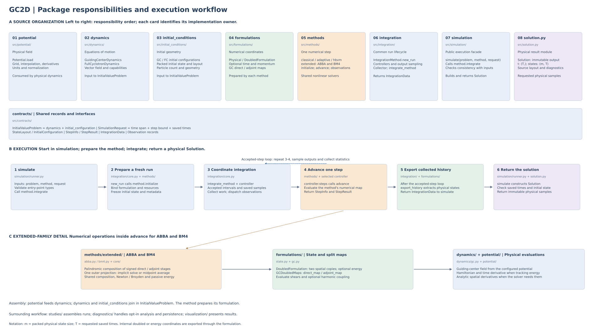

# Integration, physical states and temporary workspaces

All public fixed methods use executor-owned preparation through their common or implicit `new_run` contract.
Execution selects the host or device driver. Dynamics defines physics and coordinate roles; formulation
prepares temporary copies; the method defines numerical operations; execution controls
accepted intervals and collects output.

`problem.py` composes dynamics, initial conditions and a request; `request.py` defines the temporal request (interval and output times); `contracts/` owns shared interfaces, step records and array compatibility. `dynamics.coordinates` owns physical structural descriptions, while reusable formulations prepare temporary copies. `methods/` implements numerical steps. `execution/` owns preparation, accepted `IntegrationState` snapshots, sampling and host/device loops; `methods.base` owns numerical preparation. `states/` owns the physical recording container and completed result. `simulation/runner.py` validates that result against the inputs and returns the same object. Internal consumers import directly from each defining module.

`IntegrationMethod.new_run(f, initial_conditions)` prepares a fresh run without
an algebraic solver or Jacobian. `ImplicitIntegrationMethod` in `methods.implicit`
adds `new_run(f, initial_conditions, *, jacobian=None)` and the solver contract;
concrete families retain their defaults. Both bases are exported from `methods`.
Explicit methods use the common base and reject the `jacobian` keyword. There
is no separate explicit base. Execution supplies derivatives only to implicit
configurations, and JAX reads derivative settings only for those runs.

Both paths call `initialize(initial_conditions)` after binding their functions.
Initial data and layout are temporary inputs; the common base retains `f`,
metadata, status and copy count, while execution owns the initial snapshot.
Only implicit runs retain `jacobian`. Supplied derivatives have independent
particle shape `(N,d,d)`; finite differences remain dense. Solver strategies,
Broyden's projection matrix and deferred derivative validation are unchanged.
There is no `jacobian_structure`, `capture_quadrature` or method-level `progress` option.

Long validation blocks are organized as private preparation functions within
their owning modules. `SimulationRequest` separates interval validation from
output-schedule normalization, and reuses the interval rule in `uniform`.
`States` prepares the physical history and immutable diagnostics separately;
the runner retains responsibility for agreement with the requested initial state
and saved times. Run preparation similarly separates initial-state ownership
and metadata freezing from the method lifecycle.

`InitialConditions` prepares its owned array, layout and particle count in one
private function. `States` shares complete-history checks between construction
and bulk recording without changing dtype; diagnostic preparation validates all
entries before copying arrays. GC/FC parameter preparation retains signed B/eta
and each model's radius constraints. Helpers return values rather than mutating
the object being constructed.

Scalar option rules shared by numerical families live in `methods._validation`.
Callers retain their existing conversion policies, including whether Boolean
values are rejected before conversion to floating point. Newton and Broyden
separate validated entry data from their iterations and reuse residual checks
without repeating a cached evaluation. Checks on convergence, singular systems,
accepted-step continuity, and newly computed non-finite values remain next to
the numerical operation that produces them. These validation helpers do not alter the numerical algorithms.

Immutable NewtonSolver/BroydenSolver configurations validate their own controls. Methods select family defaults and reject unsupported solver combinations; there is no second method-level tolerance/Jacobian configuration or precedence merge. Shared derivative preparation lives in `solvers.derivatives`, while each method retains its stage equations and residual assembly.

The downstream packages follow the same ownership convention. Studies share
scalar and sampling rules in `studies._validation` and aligned comparison
records in `studies._comparison_validation`; scientific identity, exact versus
tolerant time alignment, and method-specific diagnostics remain local to each
study family. Diagnostics prepare typed observation records before analysis and
keep sequence and sampling checks at their original state transitions. File
readers retain their format-specific integrity checks. Visualization prepares
validated series before creating figures and shares planar-solution and
animation controls through private package modules, preserving each animator's
frame-count policy. The separately packaged Poincare batch runtime keeps its
validation helpers within the files shipped to workers.

Common comparison preparation separates method-table alignment, per-run records
and sampling/reference constraints. Poincare configuration keeps its stricter
numeric and Python-integer policies in local helpers. Plot preparation includes
every series, even a later one after a valid entry, before creating a figure;
invalid energy, symplecticity, iteration and accuracy inputs therefore leave
existing figures untouched. `tests/test_plot_input_preparation.py` checks this
boundary and the curves produced for valid data.

## Package workflow diagram

Open the [SVG](package-workflow-architecture.svg),
[PNG](package-workflow-architecture.png), or
[PlantUML/Graphviz source](package-workflow-architecture.puml).
The previous detailed integration lifecycle is preserved as
[`integration-architecture_old.puml`](integration-architecture_old.puml),
with its [SVG](integration-architecture_old.svg) and
[PNG](integration-architecture_old.png) renderings.

The diagram is a historical rendering, retained without regeneration. Its collector/result split and old module routes have been superseded. The current flow is:

`EnergyObserver()` records physical H and the positive analytic partial time derivative `hamiltonian_time_derivative` at accepted endpoints and requested physical samples. It does not consume internal stages or integrate momentum. Per-step diagnostics are `energy_start`, `energy_end`, `energy_change`, `energy_time_derivative_start` and `energy_time_derivative_end`, with shape `(steps,N)`. Saved histories `physical_hamiltonian` (alias `hamiltonian`), `energy_drift` and `hamiltonian_time_derivative` have shape `(N,T)`. Energy variation in a time-dependent Hamiltonian is not a numerical conservation error.

The initial state and a saved sample can have identical values while serving different roles. No sample becomes the next main state. Formulations are shared across methods; layout, time control and numerical stepping remain separate responsibilities. JAX retains functional device arrays inside compiled loops and records its exported physical history with `States.record_history`. `Execution.run` owns the single allocation and finalization boundary for both workers.

## Public API and imports

Use `from simulation import ABBA4Implicit, BM4Implicit, simulate` for the public
execution API. `methods`, `methods.palindromic`, `formulations`, and `execution`
also declare their supported exports explicitly. `contracts` exposes types from
its individual submodules; its package initializer deliberately exports no names.
Every exported class or function has one implementation; public re-exports refer
to that same object. Internal modules do not import through the `simulation`
facade. Studies call `simulation.runner.simulate` directly.

The following old routes have been removed after migrating supported consumers:

| Removed route | Current owner |
|---|---|
| `contracts.execution.Execution` | `execution.Execution` for the executor; `execution.options.ExecutionOptions` for backend choices |
| `simulation.methods.*` | `methods.*` |
| `simulation.formulations.*` | `formulations.*` |
| `simulation.integration`, `simulation._fixed` | `methods.base`, `execution._host` |
| `simulation.configuration`, `.observation` | Corresponding `contracts` submodules |
| `simulation.problem`, `contracts.problem` | `problem` |
| `contracts.execution_options` | `execution.options` |
| `simulation.request`, `contracts.request` | `request` |
| `simulation._result` | `contracts.states.history` |
| `simulation.solution`, `solution` | `states.history` |
| `methods.abba.*`, `methods.bm4.*` | `methods.palindromic` public exports and their defining modules |
| `methods._abba_coefficients` | `methods.palindromic.core.composition` |
| Full time/momentum projection modules | Removed; use spatial projection with `EnergyObserver()` for new studies |
| `methods.extended.order4_implicit_single_projection` | `methods.palindromic.abba4_implicit.ABBA4Implicit`; shared projection in `methods.palindromic.core.projection` |

No import hooks or `sys.modules` aliases recreate those paths. Deprecated
execution classes, method factories, and full-projection studies have also been
removed; see the [API migration guide](api-migration.md).
`tests/test_package_layout.py` checks the package boundaries and declared exports.

## Execution and state ownership

The `simulate` function validates its inputs and delegates each complete job to
`execution.execution.Execution`. The local executor prepares a fresh run through
`new_run`, allocates one recorder, invokes the host or compiled worker and finalizes that same result. Subclasses may perform the whole job
elsewhere. See the [executor contract](execution.md). `States` validates and copies
physical arrays, including dimensions, finite values and packed layout. The entry
point checks saved times, state size and initial data against the request and
problem and returns the same completed object.

`simulate(..., options=ExecutionOptions(...))` optionally selects JAX for every
built-in method. The executor resolves the device, prepares field evaluation and
creates a fresh run. Fixed methods expose a device map used by the common compiled
driver; DOP853/Radau receive prepared field/energy callbacks and retain SciPy control.
Both return NumPy `States`. Omitting options preserves the default CPU controller.
See the [JAX execution contract](jax-execution.md) for scope and limitations.

Runge--Kutta stage equations live in the reusable explicit, diagonal and coupled classes under `methods.runge_kutta`; concrete recipes provide immutable Butcher tableaux. Field validation and particle/dense derivative layouts use `methods.runge_kutta._jacobians`, while finite differences use `solvers.derivatives`. Physical split maps return optional weighted stage data. Passive energy arithmetic belongs to `diagnostics.methods.energy`; `methods._momentum` and `methods.palindromic.core.energy` are removed.

`DoubleFormulation(physical_size)` is the only state formulation. It prepares two temporary physical copies through `lift`, `join_copies` and `split_copies`, preserving NumPy/JAX backends and complete FC velocity blocks. It stores only a positive vector size; it owns no dynamics, layout, time, momentum, solver or projection. Methods using ordinary physical arrays need no formulation; `SingleFormulation` is removed.

Every accepted `IntegrationState(time, values)` contains only a scalar time and an owned physical vector `(d*N,)`. Sampling snapshots carry no quadrature or momentum. `DoubleFormulation(physical_size)` creates temporary copies only for doubled methods; its size belongs to that representation, not to IntegrationMethod. Shadow samples use independent shortened maps from the accepted left endpoint and do not change the main trajectory.

Fixed controllers reuse accepted endpoint states and compute off-grid samples with
independent shortened maps.
Diagnostic times come directly from each scalar sample time.
The coordinator and `States` do not inspect clock indices or tracking flags.
Observer snapshots cannot mutate
samples or counters. Repeated runs own fresh solver resources.

The former `fully_extended` selector is rejected. It described spatial, time and
momentum projection in eight duplicated coordinates and is not an energy-monitoring
option. Existing historical full-state diagnostics are readers of that former
record type, not an active simulation path. Canonical model guides and theory
PDFs document the current methods; older rendered diagrams are historical.

## Comparison and archive record ownership

The three-, four-, and five-method studies share numerical setup, method
construction, aligned-result validation, and metric reductions through
`studies._comparison`. Their public configuration and result classes remain
available from their existing study modules and the `studies` facade. The family
configurations and results are siblings of neutral common bases; adding a method
does not make one campaign depend on another campaign's private functions. The
three- and four-method runners retain their alternating timing order. The
five-method runner retains reference reuse, optional parallel model campaigns,
and completion logging.

`contracts.studies.comparison` owns immutable reference and accuracy series, execution
records, and comparison summary records. `ComparisonReadView` describes the
shared read interface of live five-method results and loaded CSV views. CSV
loading constructs these concrete records rather than mutable attribute bags;
the existing CSV schema, public loader, and public study imports are preserved.
New numerical consumers read the canonical `residual_evaluations` complete-step
series.

`contracts.studies.gc_energy_bound` owns `GCEnergyBoundResult`;
`contracts.studies.bm4_parallel_recurrence` owns `ParallelBM4RecurrenceConfig`
and `ParallelBM4RecurrenceResult`. The existing
study modules explicitly re-export these classes. Their HDF5/NPZ loaders and
visualizers import the record owners directly, so reading an archive does not
import study orchestration or execute a simulation. Existing energy and parallel
recurrence archive schemas are unchanged. Scalar configuration rules shared with
those records live in `contracts.studies._validation`; study-specific geometry,
reference identity, and execution policies remain in `studies`.

## Problem, options and diagnostic ownership

`problem.InitialValueProblem` associates compatible dynamics and initial values;
`simulation` re-exports that same class. `execution.options.ExecutionOptions`
owns backend/device choices and is also exported by `execution`. These objects
retain their validation and snapshots. Importing the physical problem does not
require the execution package.

`diagnostics.studies.comparison` owns reference RMS floors and physical-energy error
reductions. `diagnostics.studies.bm4_recurrence.recurrence_distances` owns periodic initial
returns. Their input records stay in `contracts.studies.comparison` and
`contracts.studies`, with validation and independent arrays but without
analysis methods or imports from diagnostics. The calculation formulas and
archive schemas are unchanged. See [API migration](api-migration.md).

`studies._validation.require_uncoupled_bm4` applies the policy for new calculations;
archive constructors retain historical coupling metadata. Shared scalar record
validation remains in `contracts.studies._validation`.

`contracts.arrays` applies the shared NumPy/JAX compatibility agreement, including
mixed values, nested sequences and tracers. It selects the array namespace, not
a device or executor, and the NumPy path does not import JAX. This narrow semantic
responsibility is retained rather than introducing a generic utilities package.

## Contract locations

Existing structural interfaces and shared records follow the source hierarchy
under `contracts/`. See the [domain map](contracts.md) for canonical imports.
Implementations remain in their own packages; contract modules do not load them
at runtime. Public facades retain their established exported names.

## Method-owned integration step

Configure fixed methods with `step`, for example `RK4(step=0.03)` (default 0.1
in runtime time units). `SimulationRequest` supplies only the interval and
output times. Complete main steps use the configured value; only the last step
is shortened to reach the final time. The method's `step` remains unchanged.
Independent shadow samples may use shorter durations without moving the main
trajectory. Host and JAX use the same schedule and record effective durations
in `step_sizes`. `advance` remains the numerical operation.

DOP853 and Radau are standalone SciPy reference solvers used directly by studies. They are no longer methods in `simulation` or `methods`, and there is no adaptive controller or SciPy/JAX hybrid path in execution. Fixed methods own `step`; requests own the interval and saved times. Host progress is configured with `options=ExecutionOptions(progress=True)`.
