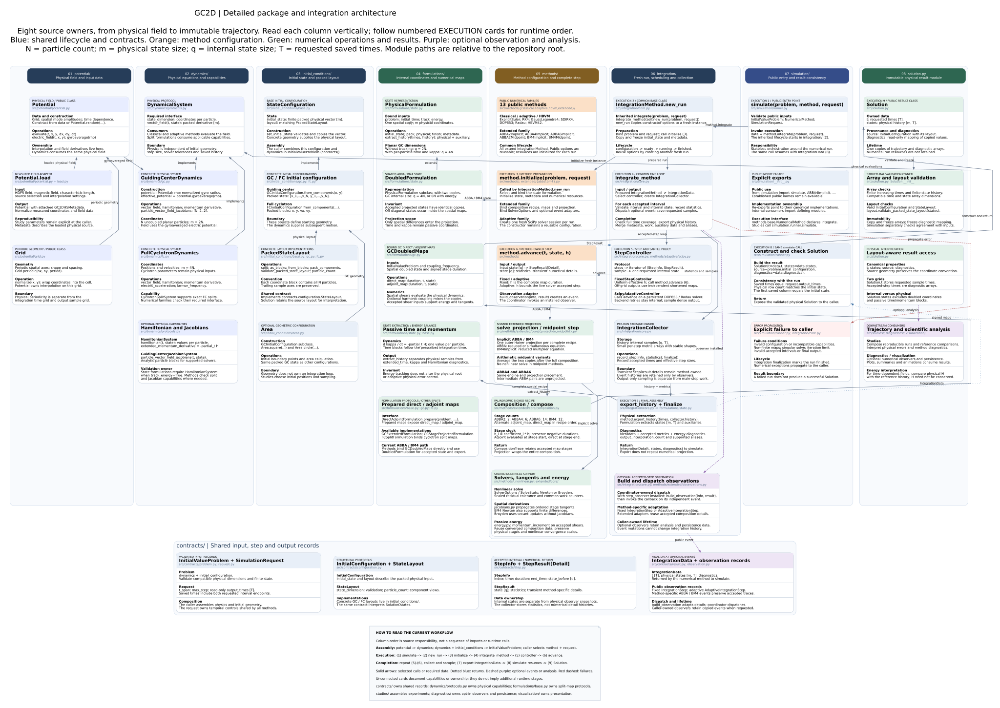

# Detailed package and integration architecture

The linked rendered diagrams and their sources are retained as historical artifacts. Their method-owned integration entry points and former state containers are superseded by the executor-owned lifecycle described in this text.



Open the scalable [SVG](package-integration-architecture.svg), the
[PNG](package-integration-architecture.png), or the canonical
[PlantUML/Graphviz source](package-integration-architecture.puml).
The diagram is intended to be viewed at full size or with zoom.

This additional view uses the column layout, colored card headers, API details
and section dividers of the [archived lifecycle](integration-architecture_old.puml).
The archived diagram and the [compact package overview](package-workflow-architecture.svg)
remain available unchanged.

## Reading the diagram

The image records the previous package organization, including the retired initial-provider, collector and result owners. Its module labels are historical. The current owners are documented in the [integration guide](integration-architecture.md): `request.py` owns temporal configuration, `formulations.layout` owns physical layouts, `execution` owns preparation and current-state control and `states` owns physical recording and results.

The historical `contracts/` band groups shared data interfaces. Physical capability protocols belong to
`dynamics/protocols.py`, split-map protocols to `formulations/base.py`, and the
public method protocol to `methods/base.py`.

Solid arrows show selected calls or required data. Dotted blue arrows show
returns; dashed purple arrows show optional observations or analysis; red dashed
arrows show error propagation. Cards without connecting arrows document ownership
and capabilities rather than extra execution stages.

## Runtime sequence

1. The caller builds dynamics and a physical initial array with its layout, then supplies a method and `request.SimulationRequest`.
2. `simulate` delegates the complete job to `Execution.run`, which prepares the environment and a fresh run through `method.new_run`, then invokes the shared integration driver.
3. The controller manages `IntegrationState(time, values)` for accepted internal endpoints. `integrate_method` prepares `States` and records the initial physical sample.
4. Each accepted interval produces main-step statistics and any requested samples. Fixed shadow maps start independently from its left endpoint; adaptive methods evaluate accepted dense output. The formulation extracts physical values before `States.record` copies them.
5. The formulation evaluates diagnostics over saved physical samples and auxiliaries. `States.finalize` checks coverage and seals the same recording object.
6. `simulate` verifies time, layout dimension and initial-state agreement and returns the completed `States` directly. JAX constructs that same result type at the host boundary from device arrays.

## Extended-family detail

ABBA and BM4 use `DoubledFormulation` for accepted state and output extraction,
and `GCDoubledMaps` for spatial `direct_map` and `adjoint_map` operations. Their
shared composition engine traverses signed palindromic recipes: 2 stages for
ABBA2, 6 for ABBA4, 14 for ABBA6, and 12 for BM4.

The implicit methods apply one outer Hairer projection around the complete
recipe. ABBA4 and ABBA6 share this execution structure; their intermediate ABBA
pairs are unprojected. Midpoint variants apply one arithmetic average after the
composition. Newton/Broyden support, analytic tangents and passive energy
quadrature reuse the shared numerical implementation and accepted stage data.

For planar guiding-center particles, physical formulations use `2N` coordinates
or `4N` with energy tracking; doubled formulations use `4N` or `6N`, respectively.
Only spatial variables enter the projection. Public result states remain
physical, while auxiliary time, momentum and energy values are diagnostics.

For method-specific details, see the
[extended-family architecture](../models/extended/simulation/extended-simulation-architecture.md)
and the [integration and state-formulation guide](integration-architecture.md).

## Regeneration

Edit `package-integration-architecture.puml`; it is the canonical source.
Its `@startdot` block is supported by PlantUML with Graphviz. The repository
renderer uses the WebAssembly Graphviz package `@viz-js/viz` and the SVG rasterizer
`sharp`, so a system Graphviz executable is optional.

With Node.js and these packages available through normal module resolution or
`NODE_PATH`, run from the repository root:

```bash
node scripts/render_detailed_architecture.cjs
```

The renderer creates the matching SVG and PNG from that single source. It writes
only `package-integration-architecture.svg` and `.png`; the compact and archived
diagrams have independent sources and renderings.
